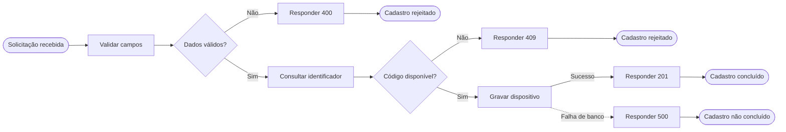
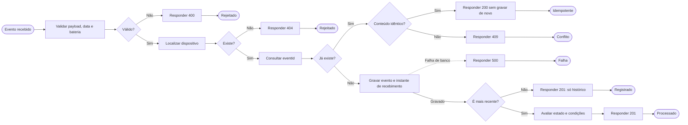

# DP-005 — BPMN 2.0: Cadastro e Ingestão de Eventos

**Versão:** 1.2  
**Status:** Revisão técnica aprovada no DP-007  
**Tipo:** Modelagem TO-BE — processo proposto para o DevicePulse  
**Card:** DP-005  
**Referências:** [DP-002](02-atores-jornadas-casos-de-uso.md), [DP-003](03-requisitos-funcionais-e-nao-funcionais.md) e [DP-004](04-regras-de-negocio-e-estados.md) — versões 1.0

## 1. Objetivo e escopo

Este documento descreve os processos de **cadastro de dispositivos fictícios** e **recebimento de eventos simulados**. A representação oficial está nos arquivos BPMN 2.0 editáveis; os desenhos Mermaid abaixo são **resumos de leitura**, não substitutos da notação BPMN.

O modelo representa um cenário **proposto (TO-BE)** para um projeto independente de portfólio; não descreve o processo real de nenhuma empresa.

### Artefatos

| Arquivo | Conteúdo | Como abrir |
| --- | --- | --- |
| [05-cadastro.bpmn](bpmn/05-cadastro.bpmn) | Cadastro, validação, duplicidade, persistência e respostas | Importar no [BPMN.io](https://demo.bpmn.io/) ou em modelador BPMN 2.0 |
| [05-ingestao.bpmn](bpmn/05-ingestao.bpmn) | Evento simulado, validações, idempotência, histórico, atualização de estado e erros | Importar no mesmo modelador |

Os arquivos `.bpmn` incluem definições de processo, gateways, eventos, fluxos de sequência, fluxos de mensagem e dados de layout BPMN DI para visualização e edição. O GitHub exibe o XML, mas **não desenha nativamente** arquivos `.bpmn`. Use o visualizador de sua escolha para inspecionar os diagramas oficiais.

## 2. Participantes e notação

Cada diagrama contém uma **colaboração com dois pools**:

- **Participante externo em pool fechado (black-box):** Operador no cadastro; Simulador na ingestão. Não modelamos seus processos internos porque não fazem parte do backend DevicePulse.
- **DevicePulse — API e regras:** pool com o fluxo de atividades sob responsabilidade do sistema.

Um **fluxo de mensagem** cruza o limite entre participantes; um **fluxo de sequência** conecta atividades dentro do processo do DevicePulse. Os dois não devem ser confundidos. Não adicionamos raias internas artificiais à API porque o escopo ainda não separa responsáveis humanos ou equipes dentro desse pool.

| Elemento BPMN | Significado aqui |
| --- | --- |
| Evento de início com mensagem | Chegada de solicitação feita pelo ator externo |
| Tarefa / tarefa de serviço | Trabalho realizado pelo backend |
| Tarefa de envio | Resposta devolvida ao participante externo |
| Gateway exclusivo (XOR) | Escolha de **um** caminho com base na condição avaliada |
| Evento de borda de erro | Falha de persistência capturada durante uma tarefa |
| Evento de fim | Encerramento do processamento daquela solicitação |
| Fluxo de sequência | Ordem das etapas no mesmo processo |
| Fluxo de mensagem | Comunicação entre participantes distintos |

## 3. Processo A — Cadastro de dispositivo

**Participante externo:** Operador de monitoramento.  
**Gatilho:** envio de solicitação de cadastro.  
**Resultado de sucesso:** dispositivo persistido, disponível para receber eventos.

### Resumo visual

### Descrição passo a passo

1. O operador encaminha nome e identificador fictício para o DevicePulse.
2. O backend valida os campos obrigatórios e o formato esperado.
3. **Se inválido:** responde com erro de validação (proposta HTTP 400) e encerra.
4. **Se válido:** consulta a existência do identificador único.
5. **Se já existir:** responde conflito (proposta HTTP 409), preservando o dispositivo original.
6. **Se estiver livre:** tenta gravar o dispositivo de modo persistente.
7. **Se gravar:** retorna sucesso de criação (proposta HTTP 201).
8. **Se a persistência falhar:** retorna falha interna (proposta HTTP 500), sem informar sucesso indevido.

> Os códigos HTTP são **propostas de comportamento** e serão ratificados no contrato REST do DP-010; o fluxo de negócio e suas saídas já podem ser modelados.

### Rastreabilidade

- **UC:** UC-001 — Cadastrar dispositivo.
- **RF:** RF-001, RF-007, RF-020.
- **RN:** RN-001.
- **Pós-condição de sucesso:** dispositivo novo registrado uma única vez.
- **Pós-condição de falha:** cadastro não realizado; informação de erro para o operador.

## 4. Processo B — Ingestão de evento simulado

**Participante externo:** Simulador de dispositivos.  
**Gatilho:** chegada de evento contendo `eventId`, `deviceId`, `occurredAt` e `batteryLevel`.  
**Resultado de sucesso:** evento registrado; quando aplicável, estado e condições operacionais reavaliados.

### Resumo visual

### Caminho normal

1. O simulador produz eventos fictícios normalmente a cada **60 segundos por dispositivo**; esse intervalo define a cadência da simulação, não o processamento da API.
2. O backend recebe o evento e valida os campos, a bateria de **0 a 100** e o horário de ocorrência.
3. Confirma que o dispositivo informado existe.
4. Consulta o `eventId` para verificar se a ocorrência já foi entregue.
5. Sendo um evento novo e válido, registra os dados de ocorrência e recebimento.
6. Se o evento representa a informação mais recente daquele dispositivo, reavalia conectividade, bateria e condições que podem gerar ou normalizar alertas.
7. Responde ao simulador com o resultado do processamento.

### Caminhos alternativos e exceções

| Situação | Tratamento previsto | Efeito no estado |
| --- | --- | --- |
| Campo ausente, bateria inválida, data futura ou payload malformado | Rejeitar; resposta proposta 400 | Não altera |
| Dispositivo não cadastrado | Rejeitar; resposta proposta 404 | Não altera |
| `eventId` repetido com payload idêntico | Responder idempotentemente; proposta 200 | Não registra novamente nem altera |
| `eventId` repetido com payload diferente | Rejeitar conflito; proposta 409 | Não sobrescreve |
| Evento válido, mas `occurredAt` antigo ou igual ao último evento aplicado | Guardar histórico e responder aceito; proposta 201 | Não substitui estado atual |
| Falha ao persistir o evento | Tratar falha e informar erro; proposta 500 | Não confirmar gravação ou atualização |
| Evento novo e mais recente | Persistir, reavaliar estado e responder aceito; proposta 201 | Pode atualizar estado e alertas |

**Consistência transacional:** gravação do evento, atualização do estado derivado e operações de alertas devem ser planejadas para não gerar confirmação parcial inconsistente. O desenho técnico dessa garantia será detalhado em DP-008 a DP-010.

### Rastreabilidade

- **UC:** UC-003 — Receber evento simulado.
- **RF:** RF-005 a RF-010, RF-012, RF-014, RF-020.
- **RN:** RN-002 a RN-006, RN-010 a RN-014, RN-017, RN-018, RN-020.
- **Valores aprovados no DP-004:** bateria baixa até 20%; timeout de conectividade acima de 300 s; verificação a cada 30 s.

## 5. Fronteiras deste card

O DP-005 **não é** o diagrama completo do ciclo de vida de alertas ou do verificador periódico de ausência de comunicação. Aqui a tarefa **Avaliar estado e condições** representa uma atividade do backend que será aprofundada em:

- **DP-006:** disparo de bateria baixa e perda de comunicação; abertura, reconhecimento e resolução de alertas.
- **DP-007:** exceções adicionais e revisão cruzada dos processos (incluindo indisponibilidade na consulta e decisões temporais).
- **DP-008 a DP-010:** responsabilidades arquiteturais, persistência e contrato REST.

O simulador, o operador e a API **não acessam dispositivos físicos ou serviços de monitoramento reais**.

## 6. Checklist de aceite para DP-005

- [ ] Ambos os arquivos `.bpmn` abrem e podem ser editados em um modelador BPMN 2.0.
- [ ] Operador, simulador e DevicePulse aparecem em pools coerentes com suas responsabilidades.
- [ ] O cadastro trata os caminhos válido, inválido, duplicado e falha de persistência.
- [ ] A ingestão trata validação, dispositivo desconhecido, idempotência, conflito e evento antigo.
- [ ] As respostas de sucesso e erro terminam os fluxos adequadamente.
- [ ] Nenhuma regra contradiz os documentos DP-001 a DP-004.
- [ ] O fluxo de ciclo de vida de alertas fica corretamente reservado ao DP-006.

**Status do documento:** versão 1.0 foi aprovada como base do DP-006. A revisão técnica 1.1 proposta no DP-007 amplia o tratamento de falhas de banco e depende de aprovação do novo card. A importação visual de `05-cadastro.bpmn` foi confirmada no BPMN.io; a abertura visual completa de `05-ingestao.bpmn` e eventuais ajustes de legibilidade ficam registrados como verificação técnica complementar para o DP-007. Os códigos de resposta HTTP permanecem propostos até o contrato REST (DP-010).

## Revisão técnica DP-007 — proposta de versão 1.1

- O BPMN de cadastro agora trata também a **falha ao consultar a existência do identificador**, não somente a falha na gravação.
- O BPMN de ingestão agora trata falhas durante **localização do dispositivo**, **consulta de `eventId`** e **avaliação do estado**.
- As saídas de erro já existentes foram reutilizadas, preservando os caminhos e o escopo aprovados; nenhum resultado de falha deve ser confirmado como sucesso.
- Foram disponibilizadas prévias SVG [do cadastro](bpmn/05-cadastro.svg) e [da ingestão](bpmn/05-ingestao.svg) derivadas do layout BPMN DI atualizado.
- Consulte a [matriz de exceções e validação BPMN](07-validacao-bpmn-e-matriz-excecoes.md) para responsabilidades, términos e política de retomada.

**Revisão 1.1 aprovada no DP-007; atualização de interpretação documental 1.2 no DP-013.** A conferência visual completa em BPMN.io permanece pendente para registro antes do portão de aprovação DP-013.

> **Interpretação dos erros HTTP pelo contrato DP-010 (v1.0):** os exemplos de falhas técnicas dos BPMNs anteriores mostram a resposta genérica `500`, mas o contrato definitivo distingue **503 — indisponibilidade conhecida** (por exemplo, banco temporariamente inacessível) e **500 — erro inesperado**. Em ambos os casos, não declarar sucesso quando a persistência for incerta. Esta nota atualiza a interpretação documental, **não altera o XML BPMN**; as legendas gráficas e sua legibilidade deverão ser conferidas/ajustadas no BPMN.io antes do aceite do DP-013.
