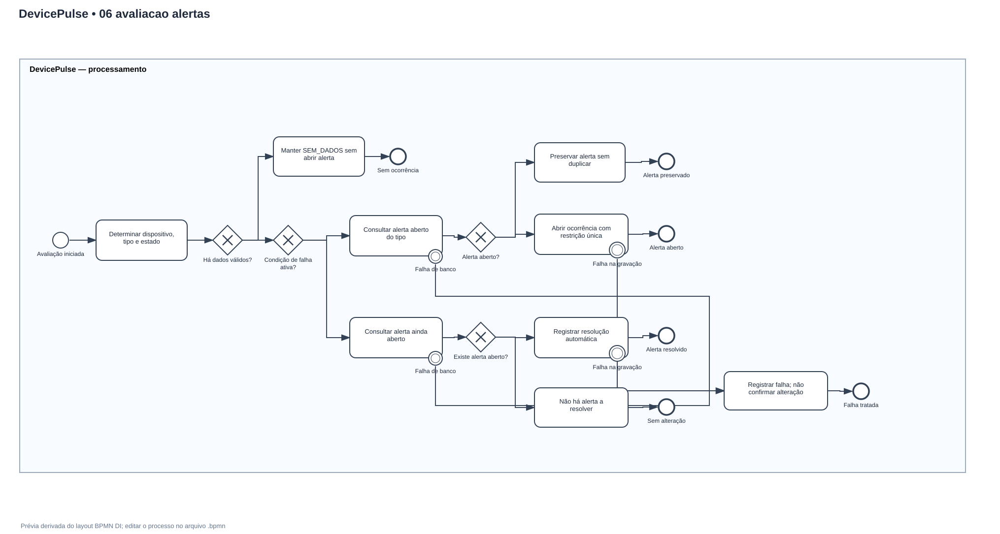
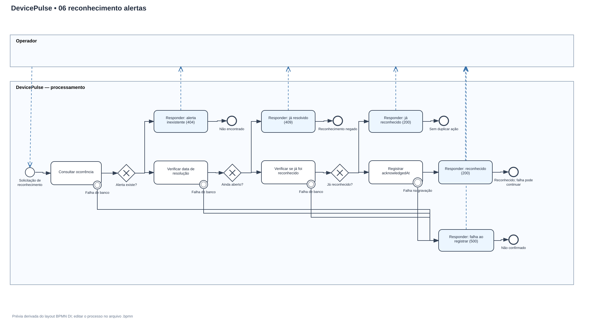

# DP-006 — BPMN 2.0: Alertas, Reconhecimento e Resolução

**Versão:** 1.2  
**Situação:** Revisão técnica aprovada no DP-007  
**Card:** DP-006  
**Tipo de processo:** TO-BE (fluxos projetados; dados fictícios)  
**Referências:** [DP-004 — Regras de Negócio e Estados](04-regras-de-negocio-e-estados.md) e [DP-005 — Cadastro e Ingestão](05-bpmn-cadastro-ingestao.md)

## 1. Objetivo

Modelar os processos que permitem ao DevicePulse identificar uma condição de falha, abrir um alerta sem duplicidade, registrar o reconhecimento pelo operador e resolver automaticamente a ocorrência quando a condição voltar ao normal.

As duas ações de **reconhecer** e **resolver** são independentes: o operador registra que viu um problema; apenas a normalização da condição determina sua resolução no MVP.

## 2. Entregáveis e visualização

| Diagrama | Arquivo BPMN editável | Prévia para o GitHub |
| --- | --- | --- |
| Avaliação, abertura e resolução automática | [06-avaliacao-alertas.bpmn](bpmn/06-avaliacao-alertas.bpmn) | [06-avaliacao-alertas.svg](bpmn/06-avaliacao-alertas.svg) |
| Reconhecimento de alerta pelo operador | [06-reconhecimento-alertas.bpmn](bpmn/06-reconhecimento-alertas.bpmn) | [06-reconhecimento-alertas.svg](bpmn/06-reconhecimento-alertas.svg) |

**Atenção:** os arquivos `.bpmn` contêm os diagramas BPMN 2.0 editáveis, incluindo os elementos do processo, fluxos e coordenadas de layout. Para abrir ou modificar, importe-os em um modelador como [BPMN.io](https://demo.bpmn.io/). Os arquivos SVG são representações visuais de apoio e podem ser vistos diretamente no GitHub, mas **não substituem** o BPMN original.

### Prévia do fluxo automático

### Prévia do reconhecimento pelo operador

## 3. Premissas de negócio aprovadas

| Aspecto | Valor ou decisão | Referência |
| --- | --- | --- |
| Bateria baixa | Menor ou igual a **20%** | RN-012 |
| Offline | Mais de **300 segundos** desde a última comunicação válida | RN-009 |
| Verificador periódico | A cada **30 segundos** | RN-011 e parâmetros |
| Simulador em operação normal | Evento fictício a cada **60 segundos por dispositivo** | Parâmetros |
| Primeiro contato pendente | `SEM_DADOS`, sem alerta de comunicação ou bateria | RN-007, RN-014 |
| Ocorrências repetidas | Máximo de **um alerta ainda aberto por dispositivo e tipo** | RN-017, RN-018 |
| Reconhecimento | Somente para alertas abertos; não resolve a falha | RN-019 |
| Resolução | Automática quando a condição normaliza, mesmo sem reconhecimento | RN-020 |
| Eventos antigos ou duplicados | Não alteram estado nem reabrem/resolvem alertas | RN-005, RN-006 |

Os tipos de alerta do MVP são `LOW_BATTERY` e `NO_COMMUNICATION`. Eles podem coexistir no mesmo dispositivo e são avaliados **separadamente**.

## 4. Diagrama A — Avaliação e ciclo automático do alerta

**Processo:** avaliação de **uma condição e um tipo de alerta por vez**.  
**Responsável:** DevicePulse (backend).  
**Gatilhos de negócio:**
1. Um novo evento válido e mais recente foi processado na ingestão (DP-005). O sistema avalia bateria e conectividade.
2. O verificador executado a cada 30 segundos reavalia a conectividade dos dispositivos que já receberam alguma comunicação.

Cada tipo é avaliado em uma execução independente do fluxo. Isso permite, por exemplo, abrir simultaneamente um alerta de bateria baixa e outro de ausência de comunicação para o mesmo dispositivo **sem combinar os dois em uma única ocorrência**.

### Etapas

1. **Iniciar avaliação:** o backend recebe o contexto do dispositivo, o tipo de alerta e o estado calculado.
2. **Verificar suficiência dos dados:** sem primeira medição, a condição fica em `SEM_DADOS`, não gerando alerta.
3. **Avaliar se a falha está presente:**
   - `LOW_BATTERY`: o último valor aplicável é menor ou igual a 20%.
   - `NO_COMMUNICATION`: existe comunicação anterior e transcorreram mais de 300 segundos.
4. **Se a condição estiver presente**, consultar ocorrência ainda não resolvida do mesmo dispositivo e tipo.
5. **Se já existir alerta aberto**, mantê-lo. Não atualizar a data original de abertura nem criar outro.
6. **Se não existir alerta aberto**, registrar uma nova ocorrência com a data/hora de abertura e `resolvedAt = null`. A restrição de unicidade deve ser aplicada no banco para evitar duplicidade concorrente.
7. **Se a condição não estiver presente**, consultar se existe ocorrência aberta daquele tipo.
8. **Se houver ocorrência aberta**, registrar sua resolução automática (`resolvedAt`), preservando `acknowledgedAt` quando já informado. É permitido resolver sem reconhecimento anterior.
9. **Se não houver ocorrência aberta**, encerrar a avaliação sem criar ou modificar alertas.
10. **Se a gravação de abertura ou resolução falhar**, registrar o erro e não confirmar alteração inexistente. Estratégia de reprocessamento e transações será refinada no DP-007 e na arquitetura/implementação.

**Saídas esperadas:** alerta criado, alerta preservado, alerta resolvido ou nenhuma alteração; falhas técnicas são tratadas sem declarar sucesso.

### Particularidades

- O verificador pode mudar `ONLINE` para `OFFLINE` quando o prazo de comunicação é excedido; não é necessário receber outro evento para detectar a falha.
- Um evento novo e válido pode normalizar conectividade, mas **não** implica automaticamente bateria normal.
- Se a comunicação cessar enquanto a última bateria conhecida era baixa, ambos os alertas podem permanecer abertos.
- Evento fora de ordem pode ser salvo no histórico, mas não modifica o estado atual. Consequentemente, não altera o ciclo de alerta.

## 5. Diagrama B — Reconhecimento de um alerta

**Processo:** solicitação do operador.  
**Pools:** Operador (participante externo) e DevicePulse (processo da API).  
**Gatilho:** tentativa de reconhecer uma ocorrência pelo painel.

### Etapas

1. O operador escolhe uma ocorrência e aciona **Reconhecer alerta**.
2. O backend consulta a ocorrência pelo identificador.
3. **Se não existir:** informa recurso não encontrado (resposta HTTP proposta: 404).
4. **Se existir, mas já estiver resolvida:** rejeita o reconhecimento tardio (resposta proposta: 409).
5. **Se ainda estiver aberta e já reconhecida:** responde de modo idempotente, sem alterar a data de reconhecimento (proposta: 200).
6. **Se estiver aberta e não reconhecida:** grava `acknowledgedAt` e confirma a operação (proposta: 200).
7. **Se ocorrer falha de persistência:** informa que o reconhecimento não foi confirmado (resposta proposta: 500).

**Pós-condição:** o reconhecimento registra a ciência do operador, **não altera a conectividade nem a bateria** e não preenche `resolvedAt`.

No MVP não há autenticação de operadores. Assim, `acknowledgedAt` registra a ação e o horário, mas não comprova a identidade de uma pessoa específica. Isso deve ser considerado antes de qualquer publicação acessível a terceiros.

**Observação:** os códigos HTTP indicados são propostas de contrato e serão confirmados no DP-010. Os fluxos estão modelados de forma não executável, para documentação.

## 6. Exemplos operacionais ponta a ponta

### Cenário 1 — Bateria baixa e reconhecida

| Momento | Ocorrência | Estado esperado |
| --- | --- | --- |
| 14:00 | Evento válido indica bateria de 15% | Abrir alerta `LOW_BATTERY` |
| 14:01 | Novo evento indica 14% | Manter o mesmo alerta aberto |
| 14:02 | Operador reconhece a ocorrência | Registrar `acknowledgedAt`; ainda aberta |
| 14:03 | Novo evento indica 75% | Registrar `resolvedAt`; alerta resolvido |

**Resultado:** uma ocorrência de bateria baixa, reconhecida e posteriormente resolvida.

### Cenário 2 — Offline sem reconhecimento

| Momento | Ocorrência | Estado esperado |
| --- | --- | --- |
| 14:00 | Última comunicação válida | Dispositivo conectado |
| Após 14:05 | Limite de 300 segundos excedido | Na próxima checagem, marcar offline e abrir `NO_COMMUNICATION` |
| 14:07 | Nova comunicação válida recente | Marcar conectado e resolver alerta |
| Depois | Operador tenta reconhecer o alerta já resolvido | Rejeitar a operação sem mudar o histórico |

**Resultado:** alerta resolvido automaticamente, com `acknowledgedAt = null`.

### Cenário 3 — Duas condições independentes

Um dispositivo comunica bateria de 10%, abrindo `LOW_BATTERY`. Depois deixa de comunicar por mais de cinco minutos e abre `NO_COMMUNICATION`. Uma nova mensagem válida com bateria de 12% restaura a conectividade e resolve o alerta offline; o alerta de bateria baixa **continua aberto**.

## 7. Exceções e garantias previstas

| Código | Situação | Comportamento esperado |
| --- | --- | --- |
| EX-01 | Mesmo estado de bateria baixa reportado repetidamente | Não duplicar alerta ativo |
| EX-02 | Verificador encontra o mesmo offline em múltiplas execuções | Manter uma única ocorrência aberta |
| EX-03 | Duas avaliações tentam abrir o mesmo tipo simultaneamente | Garantir unicidade no banco e tratar conflito transacional |
| EX-04 | Alerta resolvido sem reconhecimento | Registrar resolução; `acknowledgedAt` continua vazio |
| EX-05 | Alerta já resolvido recebe tentativa de reconhecimento | Rejeitar sem alterar dados |
| EX-06 | Operador repete reconhecimento do mesmo alerta aberto | Retornar resultado idempotente |
| EX-07 | Eventos atrasados ou duplicados | Não atualizar alertas atuais |
| EX-08 | Banco indisponível durante abertura/resolução/reconhecimento | Não retornar sucesso; registrar falha e definir política de retomada |
| EX-09 | Dispositivo ainda sem primeira comunicação | Estado `SEM_DADOS`; não abrir alerta |
| EX-10 | Bateria baixa e offline coexistem | Manter duas ocorrências distintas |
| EX-11 | Normalização de somente uma das duas condições | Resolver apenas a ocorrência correspondente |

O DP-007 detalhará as exceções transversais, a retomada após falhas técnicas e os possíveis pontos de corrida entre processos.

## 8. Rastreabilidade

| Processo | Requisitos | Regras de negócio |
| --- | --- | --- |
| Avaliação e abertura de alertas | RF-009 a RF-014, RF-017 | RN-007 a RN-018 |
| Normalização automática | RF-010, RF-011, RF-016, RF-017 | RN-010, RN-013, RN-015, RN-020 a RN-023 |
| Reconhecimento pelo operador | RF-015, RF-017, RF-020 | RN-019 a RN-021 |
| Preservação de histórico | RF-008, RF-017 | RN-006, RN-021, RN-022 |

## 9. Como interpretar os diagramas

- **Círculo inicial:** o processo foi acionado.
- **Retângulo arredondado:** atividade executada pelo backend.
- **Losango com X:** uma decisão com caminhos mutuamente exclusivos.
- **Tarefa de envio:** resposta enviada ao operador.
- **Círculo associado à borda de tarefa:** erro de persistência capturado naquela atividade.
- **Círculo final:** a execução daquele caminho terminou.
- **Linha contínua:** sequência dentro do mesmo processo.
- **Linha tracejada:** comunicação entre operador e DevicePulse, no segundo BPMN.

O diagrama A representa **uma avaliação por tipo de alerta**, independentemente do tipo de falha. No diagrama B, o operador **não** realiza a atividade de resolução: isso é responsabilidade do backend no diagrama A.

## 10. Checklist de revisão

- [ ] Os dois arquivos `.bpmn` abrem no BPMN.io e permitem edição.
- [ ] As prévias SVG permitem acompanhar os caminhos sem baixar arquivos.
- [ ] O fluxo automático contempla bateria baixa, ausência de comunicação e normalização.
- [ ] Há no máximo um alerta **aberto** por tipo e dispositivo.
- [ ] O reconhecimento é independente da resolução e só ocorre em alerta aberto.
- [ ] A resolução é automática e pode ocorrer mesmo sem reconhecimento.
- [ ] Os caminhos de erro e duplicidade estão documentados.
- [ ] Os fluxos são coerentes com DP-004 e DP-005.
- [ ] O DP-007 está reservado para consolidar exceções e validar diagramas cruzados.

**Aprovação:** os fluxos e a documentação do DP-006 foram aprovados para integração à `main`. **Verificação técnica pendente:** a importação e a legibilidade final dos arquivos `.bpmn` no BPMN.io continuam como atividade do DP-007; a aprovação do conteúdo não equivale a afirmar que essa verificação já foi executada.

**Próximo card:** DP-007 — Validar BPMNs e documentar exceções operacionais (em execução).

---

*Documento de modelagem para um sistema fictício de demonstração. Não representa processos operacionais reais de empresas de monitoramento.*

## Revisão técnica DP-007 — proposta de versão 1.1

- O BPMN de avaliação de alertas agora trata erros ao **consultar alertas abertos** e ao **consultar ocorrências para resolução**, além das falhas de gravação.
- O BPMN de reconhecimento agora trata falhas na consulta de ocorrências, na checagem de resolução e na verificação de reconhecimento prévio.
- As prévias SVG de ambos os processos foram atualizadas para acompanhar o layout BPMN DI revisado.
- Os comportamentos aprovados (limite de bateria, timeout, reconhecimento independente da resolução e unicidade de alerta aberto) permanecem inalterados.
- Consulte [DP-007 — Matriz de exceções](07-validacao-bpmn-e-matriz-excecoes.md) para responsabilidades, respostas e retomada operacional.

**Revisão 1.1 aprovada no DP-007; atualização de interpretação documental 1.2 no DP-013.** A validação visual dos arquivos BPMN no BPMN.io continua pendente para registro antes do portão de aprovação DP-013.

> **Interpretação dos erros HTTP pelo contrato DP-010 (v1.0):** os exemplos de falhas técnicas dos BPMNs anteriores mostram a resposta genérica `500`, mas o contrato definitivo distingue **503 — indisponibilidade conhecida** (por exemplo, banco temporariamente inacessível) e **500 — erro inesperado**. Em ambos os casos, não declarar sucesso quando a persistência for incerta. Esta nota atualiza a interpretação documental, **não altera o XML BPMN**; as legendas gráficas e sua legibilidade deverão ser conferidas/ajustadas no BPMN.io antes do aceite do DP-013.
