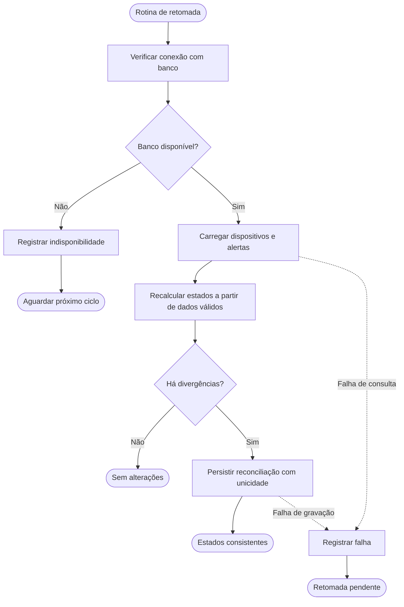

# DP-007 — Validação cruzada dos BPMNs e matriz de exceções

**Versão:** 1.1  
**Situação:** Aprovado quanto ao conteúdo e à revisão documental  
**Card:** DP-007  
**Base:** DP-003 — requisitos, DP-004 — regras de negócio, DP-005 — cadastro/ingestão e DP-006 — alertas (versões aprovadas na `main`).

## 1. Objetivo

Verificar se os fluxos BPMN do DevicePulse contemplam resultados esperados, erros e recuperação sem contrariar as regras aprovadas. O sistema usa **somente dispositivos e eventos fictícios**.

A validação deve responder, para cada cenário:
1. O que dispara a exceção?
2. Quem é responsável por identificá-la e tratá-la?
3. Qual resposta ou registro o sistema deve produzir?
4. Onde o processo termina e o que permanece preservado?
5. Qual requisito e regra justificam o comportamento?

## 2. Artefatos revisados neste card

| Diagrama oficial BPMN 2.0 | Prévia SVG | Cobertura |
| --- | --- | --- |
| [05-cadastro.bpmn](bpmn/05-cadastro.bpmn) | [Cadastro](bpmn/05-cadastro.svg) | Validação, duplicidade, falha de **consulta** e persistência |
| [05-ingestao.bpmn](bpmn/05-ingestao.bpmn) | [Ingestão](bpmn/05-ingestao.svg) | Payload inválido, dispositivo inexistente, idempotência, evento atrasado, falhas de consulta, persistência ou avaliação |
| [06-avaliacao-alertas.bpmn](bpmn/06-avaliacao-alertas.bpmn) | [Avaliação de alertas](bpmn/06-avaliacao-alertas.svg) | Baixa bateria/offline, ausência de dados, alerta já aberto, resolução, falha nas consultas e gravações |
| [06-reconhecimento-alertas.bpmn](bpmn/06-reconhecimento-alertas.bpmn) | [Reconhecimento](bpmn/06-reconhecimento-alertas.svg) | Inexistente, resolvido, reconhecimento repetido, falha de leitura ou gravação |
| [07-retomada-operacional.bpmn](bpmn/07-retomada-operacional.bpmn) | [Retomada operacional](bpmn/07-retomada-operacional.svg) | Banco indisponível, retorno do serviço, recálculo e reconciliação dos estados |

**Arquivos editáveis:** para examinar os BPMNs reais e não somente as prévias, importe os arquivos `.bpmn` no [BPMN.io](https://demo.bpmn.io/). As prévias SVG são geradas com base no layout BPMN DI e não são o formato editável oficial.

## 3. Matriz de exceções, responsabilidades e saídas

**Legenda de respostas — atualização DP-013:** o contrato **DP-010/OpenAPI 1.0** prevalece para a resposta HTTP: **503** quando a falha é uma indisponibilidade temporária conhecida (ex.: banco inacessível) e **500** para uma falha interna inesperada. Os diagramas históricos DP-005/006 contêm ramos genéricos rotulados 500; devem ser interpretados como erro técnico **sem sucesso falso** e suas legendas visuais precisam ser alinhadas/conferidas no modelador antes de concluir o gate. Para processos internos/programados, a coluna “Resposta” descreve a ação e não uma resposta HTTP.

| ID | Processo / exceção | Responsável | Resposta ou ação prevista | Término e integridade | Rastreio |
| --- | --- | --- | --- | --- | --- |
| **EX-01** | Cadastro com campos ausentes/inválidos | API, validação | Rejeitar, HTTP 400 (proposto) | Encerra sem criar dispositivo | RF-001, RF-007; RN-001 |
| **EX-02** | Identificador de dispositivo já existente | API + banco | Rejeitar, HTTP 409 | Encerra preservando cadastro original | RF-001; RN-001 |
| **EX-03** | Banco indisponível ao consultar identificador | API | 503 SERVICE_UNAVAILABLE se indisponibilidade conhecida; registrar falha | Encerra sem confirmar cadastro | RNF-003, RF-020 |
| **EX-04** | Falha de persistência do cadastro | API + banco | 503 se indisponibilidade conhecida; 500 se falha inesperada | Encerra sem confirmar cadastro; reconsultar antes de eventual reenvio | RF-001, RF-020; RN-001 |
| **EX-05** | Payload ausente, bateria < 0 ou > 100, data inválida/futura | API, validação | Rejeitar HTTP 400, informar campo/causa sem expor detalhes internos | Encerra; não registra evento nem altera estado/alertas | RF-006/007; RN-003/004 |
| **EX-06** | Evento destinado a dispositivo inexistente | API + banco | Rejeitar HTTP 404 | Encerra sem inserir evento/alerta | RF-006/007; RN-004 |
| **EX-07** | `eventId` igual com payload idêntico | API + banco | HTTP 200 idempotente | Encerra sem registrar outro evento ou alterar estados | RF-006/008; RN-002/005 |
| **EX-08** | `eventId` já usado com payload divergente | API + banco | Rejeitar HTTP 409 | Encerra, preservando payload original e estado | RF-006/007; RN-005 |
| **EX-09** | Evento válido com horário igual/anterior ao último aplicado | Backend + banco | Inserir no histórico; responder 201 (proposto) | Encerra **sem alterar o estado atual ou alertas** | RF-008/010; RN-006 |
| **EX-10** | Banco indisponível ao localizar dispositivo ou conferir eventId | API + banco | 503 se indisponibilidade conhecida; registrar diagnóstico interno | Encerra sem confirmar processamento | RF-020; RNF-003 |
| **EX-11** | Banco falha durante gravação de evento | API + banco | 503 se indisponibilidade conhecida; 500 se erro inesperado; não declarar sucesso | Encerra sem confirmar evento; reenviar com o **mesmo** `eventId` após recuperação | RN-005/006; RNF-003 |
| **EX-12** | Falha durante a avaliação de estado/alerta após o evento | Backend + banco | 500 se falha inesperada; 503 se indisponibilidade conhecida; controlar rollback ou recuperação consistente | Encerra sem sucesso parcial declarado; transação deve impedir histórico/estado divergentes | RF-010/014; RNF-003 |
| **EX-13** | Dispositivo recém-cadastrado e sem eventos | Backend | Manter `SEM_DADOS` / “Aguardando dados” | Encerra avaliação sem alerta | RN-007/014 |
| **EX-14** | Novo evento mantém bateria baixa ou verificador mantém offline | Motor de alertas | Consultar ocorrência aberta e preservá-la | Encerra sem novo alerta; `openedAt` original preservado | RF-012/013/014; RN-017/018 |
| **EX-15** | Duas avaliações concorrentes tentam abrir o mesmo alerta | Backend + banco | Restringir único aberto por dispositivo/tipo; operação transacional | Somente um alerta permanece aberto; outro processamento reconhece resultado persistido | RN-018; RNF-003 |
| **EX-16** | Alerta já resolvido e operador tenta reconhecê-lo | API + backend | Rejeitar HTTP 409 | Encerra sem modificar `acknowledgedAt` | RF-015; RN-019 |
| **EX-17** | Operador reconhece novamente alerta ainda aberto | API + backend | Responder 200 idempotente | Encerra sem alterar horário anterior | RF-015; RN-019 |
| **EX-18** | Reconhecimento de alerta inexistente | API | Responder 404 | Encerra sem mudança de dados | RF-015/020 |
| **EX-19** | Banco indisponível na consulta ou gravação do reconhecimento | API + banco | 503 se indisponibilidade conhecida; 500 se erro inesperado; registrar falha | Encerra sem confirmar reconhecimento | RF-015/020; RNF-003 |
| **EX-20** | Falha ao consultar/gravar abertura ou resolução de alerta | Motor de alertas + banco | Registrar falha e sinalizar operação não concluída | Encerra a tentativa; exige reconciliação ao restabelecer serviço | RF-014/016; RN-018/020 |
| **EX-21** | Bateria ou comunicação normaliza sem reconhecimento prévio | Motor de alertas | Registrar `resolvedAt`; manter `acknowledgedAt = null` | Encerra com alerta histórico resolvido | RF-016; RN-019/020/021 |
| **EX-22** | Perda de comunicação por mais de 300 s | Verificador interno (30 s) | Marcar `OFFLINE` e abrir/manter alerta `NO_COMMUNICATION` | Encerra ciclo sem depender de evento recebido | RF-011/013; RN-008/011/017 |
| **EX-23** | Comunicação retorna com nova medição válida | Ingestão + motor de alertas | Marcar `ONLINE`; resolver alerta `NO_COMMUNICATION` | Encerra preservando histórico; alerta de bateria continua se bateria <=20% | RF-010/016; RN-010/020/023 |
| **EX-24** | Banco indisponível durante ciclo periódico | Verificador interno | Registrar indisponibilidade; não confirmar novos estados | Encerra ciclo sem alterações; próxima execução reavalia | RF-011/020; RNF-003 |
| **EX-25** | Banco restabelecido após interrupção | Verificador + backend | Recarregar últimas comunicações e alertas; recalcular; reconciliar divergências | Encerra com dados consistentes ou registra falha para ciclo seguinte | RF-011/014/016; RN-011/018/020 |
| **EX-26** | Evento enviado durante a indisponibilidade e não confirmado | Simulador + API | Após recuperação, **reenvio controlado** com mesmo `eventId`, passando pela ingestão idempotente | Encerra com evento aceito/registrado ou erro explícito; não pressupõe fila automática | RF-006/008; RN-005 |
| **EX-27** | Bateria baixa e offline simultâneos | Backend | Avaliar `LOW_BATTERY` e `NO_COMMUNICATION` separadamente | Duas ocorrências independentes; normalizar uma não encerra outra | RN-015/023 |

## 4. Fluxo específico de recuperação

O diagrama [07-retomada-operacional.bpmn](bpmn/07-retomada-operacional.bpmn) registra o comportamento esperado após falha de infraestrutura:

**Importante:** o diagrama não promete reexecutar automaticamente solicitações perdidas no simulador. O reenvio do produtor, quando realizado, **reutiliza o `eventId` original** e passa pelo processo de ingestão (EX-26).

A reconciliação precisa ser idempotente e usar as últimas medições válidas e o relógio da aplicação. Uma ausência de comunicação persistente pode gerar ou manter alerta offline na próxima verificação; após restabelecimento, o backend deve preservar `acknowledgedAt` e os alertas históricos já resolvidos.

### Recuperação e transações

- **Persistência de evento + atualização do estado e de alertas:** projetar um limite transacional consistente. Se a operação falhar antes de confirmar a transação, não publicar sucesso parcial. O mecanismo exato será decidido no DP-008/DP-009.
- **Identificador único de evento:** estabelecer restrição no banco; duas requisições simultâneas do mesmo `eventId` não devem gerar registros duplicados.
- **Alerta único ativo por dispositivo/tipo:** impor unicidade de alerta aberto no banco, não depender somente de consulta anterior.
- **Reconhecimento concorrente com resolução:** atualizar `acknowledgedAt` condicionalmente a `resolvedAt IS NULL`, evitando confirmar reconhecimento tardio após resolução.
- **Banco ainda indisponível:** não executar alterações, registrar a ocorrência e encerrar o ciclo; verificar de novo no ciclo seguinte, sem repetição em alta frequência.
- **Após recuperação:** reconciliar estados a partir das medições válidas; não presumir que histórico perdido durante a indisponibilidade possa ser recuperado sem reenvio.

## 5. Revisão cruzada por documento e processo

| Origem | Verificação realizada no DP-007 | Situação |
| --- | --- | --- |
| **DP-003 / RF-001, 006, 007, 008, 010, 020** | Cadastro, validação, ingestão, histórico, respostas coerentes | Documentado |
| **DP-004 / RN-001 a RN-006** | Identificação única, rejeição, duplicidade, eventos fora de ordem | Documentado |
| **DP-004 / RN-007 a RN-015** | Estado inicial, offline após 300 s, bateria <=20%, recuperação de comunicação | Documentado |
| **DP-004 / RN-016 a RN-023** | Unicidade de alerta aberto, reconhecimento distinto de resolução, recorrência | Documentado |
| **DP-005 / Cadastro** | Incluído tratamento de falha durante consulta ao código (além da gravação) | BPMN revisado |
| **DP-005 / Ingestão** | Incluídas falhas durante consultas e avaliação do estado | BPMN revisado |
| **DP-006 / Avaliação** | Incluídas falhas durante consulta de alertas | BPMN revisado |
| **DP-006 / Reconhecimento** | Incluídas falhas de consulta, preservando caminhos de registro e erro | BPMN revisado |
| **DP-007 / Retomada** | Incluído novo BPMN com falha do banco, rechecagem e reconciliação | BPMN criado |

Os fluxos modelam respostas de sucesso e de erro, mas **não são executáveis nem substituem testes de integração**. A implementação real das garantias será validada no backend.

## 6. Evidências e limites da validação

**Validação estrutural automatizada:** checar estrutura XML dos `.bpmn`, unicidade de identificadores, referências a elementos, caminhos de saída, BPMN DI (formas e setas), presença de arquivo SVG correspondente e links da documentação.

**Validação visual pendente:** importar individualmente os **cinco** arquivos BPMN no BPMN.io e verificar gateways, caminhos de exceção, setas de mensagem, sobreposições e legibilidade. A abertura prévia de **05-cadastro.bpmn** já foi demonstrada; os demais ainda exigem conferência visual. **A aprovação do documento não comprova a realização desta verificação.** Essa pendência deve ser registrada e resolvida antes da aprovação final da documentação no DP-013.

**Compatibilidade semântica BPMN:** conferência estrutural automatizada não equivale à validação completa pelo motor/modelador BPMN, nem à execução de regras. A revisão documental do DP-007 foi aprovada; a verificação visual externa no BPMN.io continua como pendência técnica para a revisão final da documentação (DP-013).

### Critérios de aceite DP-007

- [ ] As 27 exceções/condições possuem responsável, tratamento e término.
- [ ] As quatro modelagens anteriores foram revisadas sem contradizer RF e RN.
- [ ] Há um fluxo de retomada após indisponibilidade do banco.
- [ ] Não ocorre duplicidade de eventos ou alertas abertos.
- [ ] Não há reconhecimento posterior à resolução.
- [ ] Eventos atrasados afetam o histórico, não o estado atual.
- [ ] Todos os diagramas BPMN podem ser abertos e editados no BPMN.io.
- [ ] As prévias SVG correspondem às versões revisadas dos arquivos BPMN.
- [ ] Os ajustes de contrato HTTP ficam claramente reservados ao DP-010.
- [x] A revisão documental do DP-007 foi aprovada antes do início de DP-008.
- [ ] A evidência da validação visual dos cinco diagramas será registrada antes do portão DP-013.

## 7. Próximos passos

**DP-008 — Arquitetura:** definir componentes e fronteiras de transações, estratégia de concorrência e retomada, proteção de dados e controles operacionais.

**DP-009 — Dados:** chaves de unicidade, índices para alertas ainda não resolvidos, carimbos de tempo, integridade referencial e histórico.

**DP-010 — API:** padronizar códigos HTTP, payloads, esquema de erro, idempotência e comportamento das tentativas de reenvio.

**DP-012 — QA:** executar cenários automáticos para EX-01 a EX-27 conforme aplicabilidade.

---

*Documento de projeto independente com equipamentos e eventos simulados. Nenhuma política operacional de empresa externa é presumida.*

> **Ressalva do DP-013:** esta atualização esclarece a precedência dos códigos HTTP aprovados, mas **não comprova** importação BPMN.io, inspeção gráfica das setas/gateways nem execução da API. A checagem visual de todos os arquivos BPMN e o alinhamento das legendas originais do XML permanecem obrigatórios antes da decisão de liberação de implementação.
