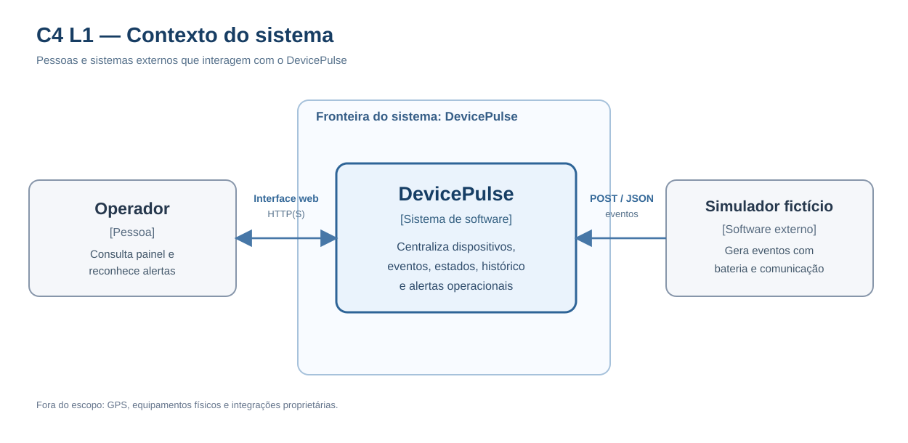
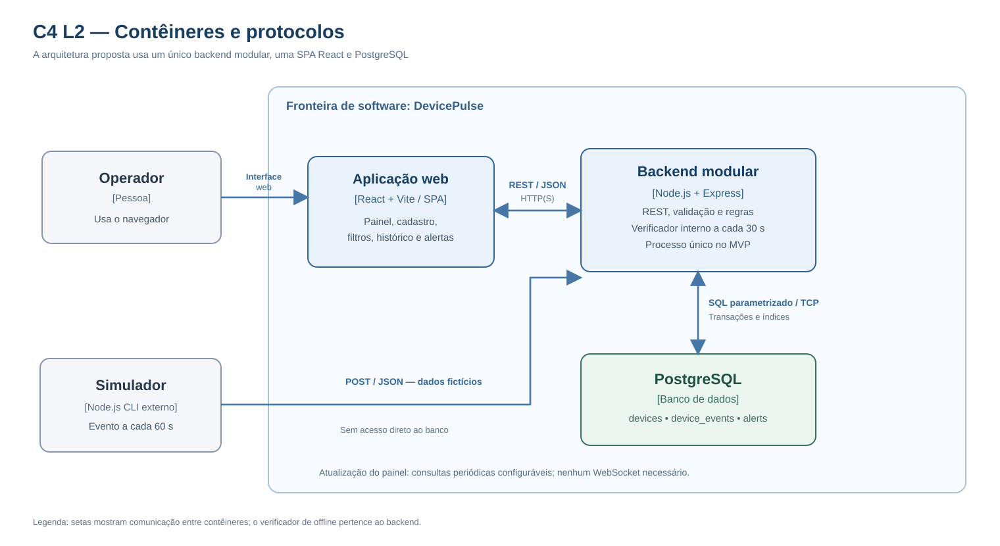

# DP-008 — Arquitetura C4 e fluxo de dados

**Versão:** 0.1  
**Situação:** Proposta para revisão  
**Projeto:** DevicePulse — dispositivos e eventos exclusivamente fictícios  
**Card:** DP-008  
**Referências:** [DP-003 — Requisitos](03-requisitos-funcionais-e-nao-funcionais.md), [DP-004 — Regras](04-regras-de-negocio-e-estados.md), [DP-007 — Exceções e BPMNs](07-validacao-bpmn-e-matriz-excecoes.md).

## 1. Objetivo

Definir o contexto do sistema e os contêineres responsáveis por transformar um evento simulado em estado operacional, histórico, alertas e indicadores exibidos ao operador.

A proposta utiliza React/Vite, Node.js/Express e PostgreSQL, com um simulador Node.js separado. O backend será um **monólito modular**, não uma rede de microserviços. Os diagramas representam arquitetura planejada; **o sistema ainda não foi implementado**.

## 2. Níveis de detalhamento do C4

- **L1 — Contexto:** apresenta o DevicePulse como um único sistema de software, o operador e o simulador externo. Não apresenta o banco nem a organização do código.
- **L2 — Contêineres:** abre a fronteira do DevicePulse e mostra a SPA React, a aplicação Node/Express e o PostgreSQL, com tecnologias e relações.
- **L3 — Componentes:** detalharia serviços e módulos internos, se necessário. A divisão preliminar é discutida na seção 7, sem transformar módulos em contêineres.

**No C4, contêiner não significa necessariamente Docker.** É uma aplicação ou armazenamento executável/implantável. O verificador offline, por exemplo, pertence ao **mesmo processo da API** no MVP.

## 3. C4 L1 — Diagrama de contexto

**Arquivos:** [Diagrama editável em Mermaid](arquitetura/08-c4-l1-contexto.mmd) · [Prévia SVG](arquitetura/08-c4-l1-contexto.svg)

| Elemento | Natureza | Responsabilidade |
| --- | --- | --- |
| Operador | Pessoa | Acessa painel, consulta dispositivos e reconhece alertas abertos. |
| Simulador de dispositivos | Software externo de teste | Produz eventos fictícios e envia JSON à API. |
| DevicePulse | Sistema de software | Centraliza cadastro, ingestão, estados, histórico, alertas e interface. |

O operador usa uma interface web; o simulador interage via HTTP POST e JSON. Nenhuma integração com hardware, GPS ou sistemas proprietários faz parte deste projeto.

## 4. C4 L2 — Diagrama de contêineres

**Arquivos:** [Diagrama editável em Mermaid](arquitetura/08-c4-l2-conteineres.mmd) · [Prévia SVG](arquitetura/08-c4-l2-conteineres.svg)

| Contêiner | Tecnologia | Responsabilidades |
| --- | --- | --- |
| Aplicação web | React, JavaScript, Vite (build/dev) | Cadastro e consulta, dashboard, filtros, detalhes, histórico, alertas, estados de erro/carregamento. |
| Backend modular | Node.js + Express | API REST, validação, regras de bateria/comunicação, ingestão idempotente, consulta, transações e alertas. |
| Banco | PostgreSQL | Dispositivos, eventos e alertas; integridade, relacionamentos, histórico e unicidade. |

O **simulador Node.js CLI** não pertence à fronteira do produto web em L2: ele é um cliente de teste separado, mesmo podendo ficar no mesmo repositório.

A verificação de offline a cada 30 segundos é uma **rotina interna da aplicação backend**. Não será criado um microsserviço só para isso.

Vite prepara e desenvolve o frontend; não executa as regras de negócio. O backend é a autoridade sobre estados e alertas; o React não determina estados oficiais sozinho.

### Interfaces e protocolos

| Comunicação | Protocolo | Informação trafegada |
| --- | --- | --- |
| Operador → aplicação web | Navegador / HTTPS se publicado | Interações com telas e formulários |
| React ↔ Express | HTTP(S) + REST + JSON | Consultas, cadastro, detalhes, histórico e reconhecimento |
| Simulador → Express | HTTP POST + JSON | eventId, deviceId, occurredAt, batteryLevel |
| Express ↔ PostgreSQL | Driver SQL via TCP | Consultas parametrizadas, gravações, índices e transações |
| Verificador → serviço de monitoramento | Chamada interna Node.js, a cada 30 s | Identificação de ausência de comunicação e reconciliação |
| React → Express (atualização visual) | GET periódico configurável | Novos indicadores e alertas; intervalo de UI ainda a definir |

**Três intervalos diferentes:** evento simulado a cada **60 s**; dispositivo fica offline após **mais de 300 s** sem comunicação válida; verificador executa a cada **30 s**. O polling da SPA é outro intervalo e será especificado com a UX, sem ser confundido com o verificador.

## 5. Fluxo completo: evento fictício até o dashboard

| Etapa | Responsável | Operação |
| --- | --- | --- |
| 1 | Simulador | Cria medição fictícia para dispositivo cadastrado; inclui identificador do evento e instante. |
| 2 | Cliente simulado → API | Envia o evento por HTTP POST JSON (rota final definida no DP-010). |
| 3 | API / camada de validação | Verifica payload, bateria 0–100, data válida, dispositivo existente e identidade do evento. |
| 4 | Backend / banco | Consulta duplicidade: mesmo evento idêntico não grava de novo; payload conflitante é rejeitado. |
| 5 | Persistência + regras | Registra evento válido e instante de recebimento; se mais recente, avalia conectividade/bateria e alertas. |
| 6 | PostgreSQL | Confirma transação coerente e protege unicidade de alertas abertos por dispositivo/tipo. |
| 7 | React → API | Busca indicadores, estados e alertas em intervalo configurável ou após uma ação. |
| 8 | API → navegador | Retorna JSON; operador visualiza o estado atualizado. |

**Exemplo:** evento com bateria 15% → backend identifica bateria baixa → consulta ocorrência ainda aberta → cria uma ocorrência apenas se necessário → grava → dashboard apresenta o alerta. Reconhecer altera o registro de ciência, **não** o estado técnico. Um novo evento com bateria normal permite resolver a ocorrência automaticamente.

A transação exata, a identidade da deduplicação e os nomes dos campos ficam para DP-009/010, sem alterar os princípios aprovados em DP-004.

### Fluxo por ausência de comunicação

1. O simulador interrompe os envios de um dispositivo que já se comunicou.
2. O backend permanece em execução, checando o histórico da última comunicação válida a cada 30 s.
3. Após exceder cinco minutos sem comunicação, marca offline e abre/mantém alerta do tipo NO_COMMUNICATION.
4. Ao receber novo evento recente, o backend pode restaurar ONLINE e resolver o alerta offline.
5. Se o último estado de bateria continuar baixo, o alerta de bateria baixa permanece aberto.

Esse processamento **não depende do navegador** e não exige WebSockets.

### Caso de falha no banco

O backend não deve retornar sucesso quando o PostgreSQL não confirmar a operação crítica. Após o restabelecimento, a rotina deve reavaliar os dados disponíveis e reconciliar estados/alertas, preservando idempotência. Isso não significa que um evento jamais enviado ou nunca reenviado possa ser recuperado magicamente.

## 6. Separação de responsabilidades e tratamento de falhas

| Situação | Onde deve ser resolvida | Garantia desejada |
| --- | --- | --- |
| Payload inválido ou dispositivo desconhecido | Validação da API | Rejeitar sem alterar estados/histórico |
| Evento duplicado | Serviço de ingestão + restrição PostgreSQL | Resultado idempotente |
| Evento atrasado | Serviço de regras + histórico | Preservar evento, sem alterar estado atual |
| Abertura simultânea do mesmo alerta | Transação e índice/constraint | Um alerta aberto por dispositivo e tipo |
| Banco indisponível | Backend + verificador interno | Sem confirmação falsa; retomada reconciliável |
| Reconhecimento de alerta já resolvido | Backend + atualização condicional | Rejeitar atualização tardia |
| Estado sem medição anterior | Serviço de monitoramento | SEM_DADOS, apresentado como “Aguardando dados” |

Referência detalhada: [matriz de exceções DP-007](07-validacao-bpmn-e-matriz-excecoes.md).

## 7. Organização modular prevista para o backend

Esses módulos dividem responsabilidades do **mesmo processo Node**, não são microserviços:

| Módulo interno | Responsabilidade |
| --- | --- |
| Rotas, controllers e validação | Entrada HTTP, conversão de dados e tratamento de erros |
| Dispositivos | Cadastro, listagem, detalhes e busca |
| Ingestão | Receber evento, tratar idempotência e ordem temporal |
| Monitoramento | Calcular SEM_DADOS, ONLINE, OFFLINE e estado de bateria |
| Alertas | Abrir, reconhecer, resolver e consultar ocorrências |
| Verificador periódico | Identificar timeout e reavaliar estados sem novo evento |
| Repositórios/transações | Acesso SQL, persistência e restrições de integridade |
| Consultas de dashboard | Entregar indicadores e dados agregados sem regras duplicadas no frontend |

A estrutura interna será detalhada durante a implementação, respeitando o contrato REST e o DER.

## 8. Segurança e restrições operacionais

- O MVP será demonstrado localmente inicialmente, sem dados reais, sem autenticação avançada e sem serviços proprietários.
- O navegador e o simulador **não** acessam PostgreSQL diretamente.
- Chaves e senhas não serão commitadas; usar variáveis de ambiente e valores de exemplo.
- Se houver publicação na internet, usar HTTPS e revisar autorização e proteção de endpoints de escrita; CORS sozinho **não substitui autenticação**.
- O processo Node deve permanecer ativo para garantir a verificação offline. Ambientes serverless que suspendam o processo não oferecem essa garantia.
- O requisito de desempenho local com até 100 dispositivos e 10 mil eventos ainda é uma **meta de teste** do DP-012, não um benchmark concluído.

## 9. Registros de decisão arquitetural (ADRs)

Consultar o arquivo [ADRs do DP-008](arquitetura/08-decisoes-arquiteturais-adrs.md) para contexto, alternativas, motivos e consequências:

| ADR | Decisão proposta |
| --- | --- |
| ADR-001 | Monólito modular Node/Express; verificador no backend |
| ADR-002 | PostgreSQL, integridade e transações |
| ADR-003 | REST/JSON com atualização periódica na SPA |
| ADR-004 | Simulador Node separado, consumindo a mesma API |
| ADR-005 | Demo local; publicação pública apenas após avaliação de segurança |

Todos os ADRs permanecem **propostos** até a aprovação deste card.

## 10. Rastreabilidade dos requisitos

| Origem | Requisito ou regra | Responsável |
| --- | --- | --- |
| DP-003 | RF-001 a RF-004 | React + API de dispositivos + banco |
| DP-003 | RF-005 a RF-008 | Simulador + ingestão + histórico |
| DP-004 | RN-005 e RN-006 (duplicidade/ordem) | Ingestão + PostgreSQL |
| DP-004 | RN-007 a RN-015 (monitoramento) | Serviço de regras + verificador |
| DP-004 | RN-016 a RN-023 (alertas) | Serviço de alertas + banco |
| DP-007 | EX-10 a EX-12 e EX-20 a EX-26 | Tratamento de falhas e reconciliação |
| DP-003 | RF-017 a RF-019 | API de consulta + React |

## 11. Decisões reservadas para documentos posteriores

- **DP-009:** entidades, campos, índice único parcial de alerta aberto, estratégia de deduplicação e migrações.
- **DP-010:** endpoints, OpenAPI, formatos JSON e códigos HTTP definitivos.
- **DP-011:** wireframes e frequência de atualização da UI.
- **DP-012:** testes de integração, concorrência, recuperação e RNFs.
- **DP-013:** ainda será necessária evidência da validação visual dos cinco BPMNs em BPMN.io antes de autorizar a codificação.

## 12. Critérios de aceite do DP-008

- [ ] L1 exibe operador, simulador externo e DevicePulse com limite do sistema.
- [ ] L2 mostra React, Node/Express e PostgreSQL com protocolos e responsabilidades.
- [ ] O fluxo desde evento fictício até dashboard é rastreável.
- [ ] O verificador de offline está dentro do backend, sem microserviço desnecessário.
- [ ] Regras de bateria, offline, eventos atrasados e deduplicação seguem o DP-004.
- [ ] Exceções e recuperação estão alinhadas ao DP-007.
- [ ] Decisões justificadas em cinco ADRs com alternativas e consequências.
- [ ] Fontes Mermaid e prévias SVG podem ser consultadas no GitHub.
- [ ] Documento e ADRs revisados antes de integrar à branch principal.

**Próxima tarefa:** DP-009 — Modelar o banco PostgreSQL e dicionário de dados.

---

*Proposta arquitetural para portfólio com dados simulados; não representa produtos ou processos internos de empresas de monitoramento.*
