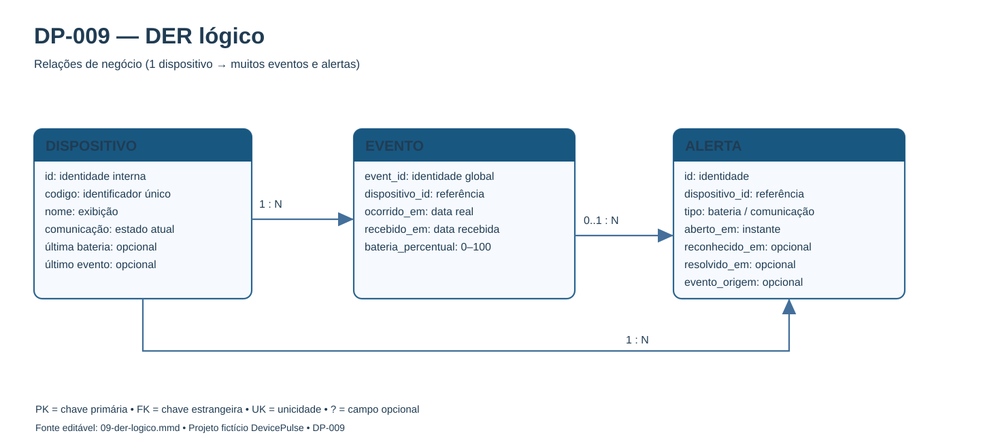
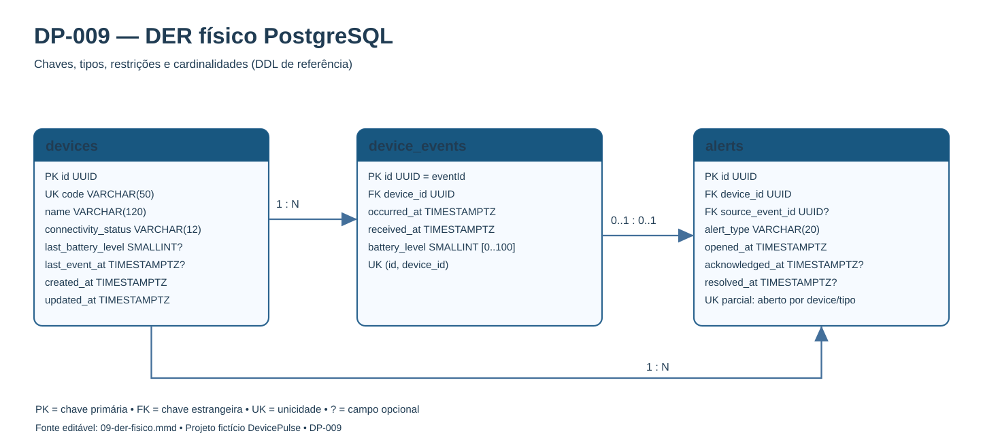

# DP-009 — Modelo de Dados, DER e Dicionário PostgreSQL

**Versão:** 1.1  
**Situação:** Aprovado em 26/10/2026 (modelagem documental)  
**Card:** DP-009  
**Projeto:** DevicePulse — dados e dispositivos fictícios  
**Dependências:** [DP-004 — Regras de negócio](04-regras-de-negocio-e-estados.md) e [DP-008 — Arquitetura C4](08-arquitetura-c4-fluxo-dados.md).

## 1. Objetivo

Definir a estrutura lógica e física para cadastrar dispositivos, receber múltiplos eventos por dispositivo, manter histórico, preservar a integridade entre entidades, impedir duplicidades e oferecer consultas confiáveis para o dashboard e a central de alertas.

O MVP usará **três tabelas de negócio**. A escolha privilegia simplicidade e consistência: não exige sistemas externos, geolocalização, dados pessoais nem microsserviços.

## 2. Entregáveis

| Entregável | Arquivo |
| --- | --- |
| DER lógico editável | [09-der-logico.mmd](dados/09-der-logico.mmd) |
| DER lógico visual | [09-der-logico.svg](dados/09-der-logico.svg) |
| DER físico editável | [09-der-fisico.mmd](dados/09-der-fisico.mmd) |
| DER físico visual | [09-der-fisico.svg](dados/09-der-fisico.svg) |
| SQL físico de referência | [09-esquema-postgresql.sql](dados/09-esquema-postgresql.sql) |
| Consultas operacionais propostas | [09-consultas-operacionais.sql](dados/09-consultas-operacionais.sql) |

Os diagramas Mermaid são as **fontes editáveis**. Os SVGs são prévias para leitura rápida diretamente no GitHub. O SQL é uma **proposta de DDL**, não uma migração executada nem evidência de que o banco já foi criado.

## 3. DER lógico — entidades e relacionamentos



### Visão do domínio

| Entidade | Significado | Cardinalidade |
| --- | --- | --- |
| **DISPOSITIVO** | Equipamento fictício identificado por código único | Um dispositivo possui zero ou muitos eventos e alertas |
| **EVENTO** | Uma medição simulada aceita e imutável | Cada evento pertence a exatamente um dispositivo |
| **ALERTA** | Ocorrência operacional de bateria baixa ou falta de comunicação | Cada alerta pertence a exatamente um dispositivo; pode ter origem em uma medição (bateria) |

**Relações:** DISPOSITIVO 1:N EVENTO; DISPOSITIVO 1:N ALERTA; EVENTO 0..1 : 0..1 ALERTA de origem. O alerta do tipo **NO_COMMUNICATION** não exige evento de origem: é gerado pela ausência de comunicação recente. O relacionamento opcional de origem é mais restritivo que o relacionamento entre dispositivos e seus históricos.

## 4. DER físico — nomes, PK/FK e tipos



### 4.1 Tabela devices — cadastro e situação atual

| Campo | Tipo | Nulo? | Regra e significado |
| --- | --- | --- | --- |
| **id** | UUID | Não | **PK** técnica do dispositivo, gerada pelo backend |
| **code** | VARCHAR(50) | Não | Código único legível na interface; **UNIQUE**; letras A–Z, números, hífen ou sublinhado |
| **name** | VARCHAR(120) | Não | Nome fictício, não pode conter somente espaços |
| **connectivity_status** | VARCHAR(12) | Não | SEM_DADOS, ONLINE ou OFFLINE; padrão SEM_DADOS |
| **last_battery_level** | SMALLINT | Sim | Última bateria considerada para o estado, entre 0 e 100 |
| **last_event_at** | TIMESTAMPTZ | Sim | Instante da **ocorrência** da medição mais recente aplicada, não da chegada à API |
| **created_at** | TIMESTAMPTZ | Não | Data/hora de cadastro |
| **updated_at** | TIMESTAMPTZ | Não | Última mudança de dados/estado, atualizada pelo backend |

**Invariante inicial:** SEM_DADOS implica **last_event_at nulo** e **last_battery_level nulo**. Após uma primeira medição aceita, ambos passam a ser preenchidos e a comunicação passa a ONLINE ou OFFLINE conforme o horário. O CHECK do banco protege essas combinações estruturais; o **tempo dinâmico de cinco minutos** é verificado na aplicação, não em um CHECK temporal.

O campo **battery_status** não é gravado: a aplicação deriva SEM_DADOS se bateria for nula; BAIXA quando menor ou igual a 20; NORMAL quando acima de 20. Isso evita armazenar um estado de bateria que poderia divergir do nível.

**Decisão proposta de identidade:** o backend atribui um UUID técnico ao dispositivo; a interface usa o campo **code** como código identificador amigável. O payload da API deve utilizar o UUID em **deviceId**, sujeito à aprovação do contrato DP-010. O código é normalizado para maiúsculas antes de persistir.

### 4.2 Tabela device_events — histórico de medições

| Campo | Tipo | Nulo? | Regra e significado |
| --- | --- | --- | --- |
| **id** | UUID | Não | **PK**, equivalente ao **eventId** fornecido pelo simulador; unicidade global |
| **device_id** | UUID | Não | **FK** para devices.id |
| **occurred_at** | TIMESTAMPTZ | Não | Momento em que a medição fictícia ocorreu |
| **received_at** | TIMESTAMPTZ | Não | Momento em que o backend gravou a medição |
| **battery_level** | SMALLINT | Não | Percentual de 0 a 100; CHECK no banco |

A mesma tabela comporta **múltiplos eventos por dispositivo**. Um evento antigo mas válido pode ser adicionado ao histórico; somente a medição cujo occurred_at seja **estritamente maior** que o último aplicado atualiza devices e pode afetar alertas.

A chave **UNIQUE(id, device_id)** dá suporte à FK composta da origem de alertas e impede que uma ocorrência de bateria seja associada a outro dispositivo. Ela complementa a PK global do evento.

**Idempotência:** o banco impede repetir o mesmo id. O serviço compara device_id, occurred_at e battery_level do registro encontrado: conteúdo igual não altera nada; conteúdo divergente é conflito. Uma chave única, por si só, não distingue essas situações; a lógica fica no backend.

### 4.3 Tabela alerts — ocorrências, reconhecimento e resolução

| Campo | Tipo | Nulo? | Regra e significado |
| --- | --- | --- | --- |
| **id** | UUID | Não | **PK** da ocorrência |
| **device_id** | UUID | Não | **FK** para devices.id |
| **alert_type** | VARCHAR(20) | Não | LOW_BATTERY ou NO_COMMUNICATION |
| **source_event_id** | UUID | Sim | Evento que originou alerta LOW_BATTERY; nulo para NO_COMMUNICATION |
| **opened_at** | TIMESTAMPTZ | Não | Data/hora de abertura |
| **acknowledged_at** | TIMESTAMPTZ | Sim | Ciência do operador; não indica normalização |
| **resolved_at** | TIMESTAMPTZ | Sim | Encerramento automático da ocorrência |

**A tabela não possui coluna status.** O estado de uma ocorrência é derivado das duas datas independentes:

| resolved_at | acknowledged_at | Estado para a interface |
| --- | --- | --- |
| NULL | NULL | Aberto, não reconhecido |
| NULL | preenchido | Aberto, reconhecido |
| preenchido | NULL | Resolvido sem reconhecimento |
| preenchido | preenchido | Resolvido após reconhecimento |

Essa representação evita combinações contraditórias de uma coluna textual com os horários.

**FK composta:** (source_event_id, device_id) → device_events(id, device_id), garantindo que um alerta de bateria aponte para um evento do próprio dispositivo. CHECK exige source_event_id para LOW_BATTERY e nulo para NO_COMMUNICATION. Índice único adicional impede que **um evento origine mais de uma abertura** de bateria.

**Ordem temporal:** acknowledged_at e resolved_at, quando preenchidos, devem ser maiores ou iguais a opened_at; se ambos existem, o reconhecimento não pode ser posterior à resolução.

## 5. Restrições e integridade

| Garantia | Implementação física |
| --- | --- |
| Dispositivo identificado unicamente | devices.id PK + devices.code UNIQUE |
| Evento globalmente único | device_events.id PK (eventId) |
| Evento vinculado a dispositivo existente | FK device_events.device_id, sem exclusão em cascata |
| Evento origem corresponde ao dispositivo do alerta | FK composta (source_event_id, device_id) |
| Bateria entre 0 e 100 | CHECK device_events.battery_level e devices.last_battery_level |
| Somente estados conhecidos de comunicação | CHECK devices.connectivity_status |
| Somente tipos conhecidos de alerta | CHECK alerts.alert_type |
| Alerta aberto único por dispositivo + tipo | **Índice UNIQUE parcial** em (device_id, alert_type) WHERE resolved_at IS NULL |
| Repetição histórica após resolução | Permitida: o índice parcial ignora alertas já resolvidos |
| Evento que origina bateria baixa só pode abrir uma ocorrência | UNIQUE parcial em source_event_id não nulo |
| Histórico não perdido por exclusão de dispositivo | FKs ON DELETE RESTRICT; excluir dispositivos com histórico não faz parte do MVP |
| Datas de reconhecimento e resolução coerentes | CHECKs de ordenação temporal |

O índice **único parcial** é importante: duas avaliações simultâneas podem encontrar que não existe alerta, mas o banco ainda impede que ambas persistam ocorrências abertas equivalentes. A documentação oficial do PostgreSQL descreve [índices únicos parciais](https://www.postgresql.org/docs/current/indexes-partial.html) e [constraints](https://www.postgresql.org/docs/current/ddl-constraints.html).

## 6. Índices para consultas operacionais

| Índice | Tabela | Objetivo |
| --- | --- | --- |
| uq_devices_code | devices | Unicidade do código |
| idx_devices_connectivity_code | devices | Filtro por ONLINE/OFFLINE/SEM_DADOS e ordenação por código |
| idx_devices_last_event_at | devices | Localizar candidatos ao timeout offline |
| idx_device_events_device_occurred | device_events | Histórico cronológico por dispositivo |
| idx_device_events_received | device_events | Auditoria em ordem de chegada |
| uq_device_events_id_device | device_events | FK composta entre alerta de bateria e evento |
| idx_alerts_device_opened | alerts | Histórico de alertas por dispositivo |
| ux_alerts_open_device_type | alerts | **Impedir duplicação de alerta aberto** |
| ux_alerts_source_event | alerts | Impedir múltiplas aberturas pela mesma medição |
| idx_alerts_open_type_opened | alerts | Central de alertas abertos por tipo |
| idx_alerts_resolved_at | alerts | Histórico de ocorrências resolvidas |

Os índices de PK também são criados automaticamente pelo PostgreSQL. Nem toda consulta precisa de um índice específico: no MVP, com o volume local planejado, o uso efetivo dos índices deverá ser medido com EXPLAIN ANALYZE e testes do DP-012.

## 7. Regras transacionais que pertencem ao backend

O DDL sozinho **não implementa as regras de negócio**. Para preservar a integridade e seguir DP-004/007/008, propomos o seguinte processo:

1. Receber e validar a requisição, incluindo horário futuro rejeitado pela API.
2. Iniciar transação e bloquear a linha de devices do dispositivo com **SELECT ... FOR UPDATE**.
3. Verificar eventId existente; se já processado, comparar payload e retornar idempotência ou conflito sem novo evento.
4. Inserir a nova medição válida no histórico.
5. Se occurred_at for igual ou anterior a last_event_at, **não modificar o estado nem os alertas**; apenas finalizar o registro histórico.
6. Se a medição for a mais recente, atualizar last_event_at, last_battery_level e connectivity_status; abrir, manter ou resolver as ocorrências necessárias na mesma transação.
7. Confirmar a transação antes de informar sucesso. Se falhar, realizar rollback e informar erro sem sucesso parcial.

Para o **verificador offline**, usar a mesma proteção transacional ao alterar estado e alertas. A consulta temporal emprega last_event_at **estritamente anterior** ao tempo atual menos 300 segundos; o intervalo da rotina permanece 30 segundos.

Para **reconhecimento**, executar UPDATE condicional exigindo **resolved_at IS NULL** e **acknowledged_at IS NULL**; se nenhuma linha for alterada, consultar o registro para diferenciar inexistente, já reconhecido e já resolvido. O backend não usa reconhecimento como sinal de normalização.

**Atenção:** não criar CHECK com NOW() para calcular status dinâmico, nem salvar status de bateria redundante. O banco mantém restrições estruturais; a aplicação calcula e reconcilia estados dependentes do relógio.

## 8. Consultas do dashboard e histórico

O arquivo [09-consultas-operacionais.sql](dados/09-consultas-operacionais.sql) documenta consultas parametrizadas para dispositivos, histórico paginado, central de alertas, indicadores, timeout offline e reconhecimento atômico.

Exemplo de uso do modelo: um dispositivo fictício com última medição de bateria de **15%** terá condição BAIXA e pode gerar LOW_BATTERY. Se parar de se comunicar por mais de 300 segundos, também poderá ter NO_COMMUNICATION; são ocorrências **independentes**. Ao voltar a transmitir bateria de 15%, o offline é resolvido, mas a bateria baixa permanece aberta.

### Payload fictício para referência (não cadastrado)

```json
{
  "eventId": "7a4c4e36-88c9-4059-aa65-9b1e0b88b4be",
  "deviceId": "383f7ac3-55f4-4891-8fa6-88253ce7b42c",
  "occurredAt": "2026-10-26T14:00:00-03:00",
  "batteryLevel": 15
}
```

Todos os identificadores e horários acima são **ilustrativos**. Não correspondem a equipamentos ou pessoas reais.

## 9. Cenários mínimos de verificação (DP-012)

| CT | Entrada ou operação | Esperado |
| --- | --- | --- |
| DB-01 | Cadastrar dispositivos com codes iguais | Segundo cadastro falha por UNIQUE |
| DB-02 | Dispositivo recém-criado | SEM_DADOS; sem horário ou nível de bateria |
| DB-03 | Inserir 3 eventos para um dispositivo | Histórico contém os 3 registros |
| DB-04 | Reenviar eventId idêntico | Nenhuma nova linha, atualização ou alerta |
| DB-05 | Reenviar eventId com payload divergente | Conflito, preserva dado original |
| DB-06 | Evento antigo após recente | Histórico aceita; devices/alerts não retrocedem |
| DB-07 | Bateria fora de 0..100 | CHECK rejeita |
| DB-08 | Evento de dispositivo inexistente | FK rejeita |
| DB-09 | Dois alertas abertos da mesma espécie/dispositivo | Índice UNIQUE parcial rejeita o segundo |
| DB-10 | Fechar alerta e ocorrer nova falha do mesmo tipo | Novo alerta permitido; anterior preservado |
| DB-11 | Reconhecer sem resolver | acknowledged_at preenchido, resolved_at NULL |
| DB-12 | Normalizar antes de reconhecimento | resolved_at preenchido, acknowledged_at NULL |
| DB-13 | Reconhecer depois de resolução | Serviço rejeita UPDATE condicional |
| DB-14 | Criar alerta LOW_BATTERY com evento de outro dispositivo | FK composta rejeita |
| DB-15 | Simular falha transacional | Nenhum sucesso parcial; rollback |
| DB-16 | Consultar 10 mil eventos / 100 dispositivos fictícios | Históricos paginados e indicadores dentro da meta RNF-004 após medição |

**Estado dos testes:** cenários **especificados**, ainda não executados. O SQL é de referência e não foi aplicado a um PostgreSQL nesta etapa.

## 10. Rastreabilidade e decisões aprovadas

| Origem | Regra/requisito | Elemento físico |
| --- | --- | --- |
| DP-003 | RF-001..RF-004, RF-018 | devices, índices de consulta |
| DP-003 | RF-005..RF-008 | device_events, FK e PK do evento |
| DP-004 | RN-001..RN-006 | PK, UNIQUE, histórico, comparação temporal |
| DP-004 | RN-007..RN-015 | last_event_at, last_battery_level, connectivity_status |
| DP-004 | RN-016..RN-023 | alerts, datas separadas, índice único parcial |
| DP-007 | EX-05..EX-12, EX-15..EX-27 | Constraints, transações, índices e reconciliação |
| DP-008 | ADR-002 (PostgreSQL) | Banco relacional único acessado pelo backend |

As seguintes escolhas do DP-009 foram **aprovadas para o MVP** no PR #9 e são a linha de base da implementação:
- **UUIDs** para identificação técnica e eventId; code amigável e normalizado para dispositivo.
- **Três tabelas** de negócio, sem tabelas extras de status ou usuários no MVP.
- **Estado atual de conectividade materializado** em devices, atualizado pelo backend; bateria classificada a partir do último valor.
- **Alerta sem status duplicado**, usando acknowledged_at e resolved_at para compor a situação.
- **source_event_id** opcional para rastrear bateria baixa e chave composta para evitar origem de outro dispositivo.
- **Restrição de unicidade parcial** para um alerta não resolvido por dispositivo/tipo e para origem de bateria.

**Definido no DP-010 (v1.0):** rotas REST, UUIDs nos campos de identificação, formatos JSON, códigos HTTP e mensagens de erro. **Reservado à implementação:** ferramenta de migrações, versões fixadas, dados seed, configuração de conexão e controle transacional em código.

## 11. Checklist de aceite da modelagem documental

- [x] DER lógico apresenta entidades e cardinalidades coerentes.
- [x] DER físico contém as três tabelas, campos, tipos, PK, FK e CHECKs.
- [x] Dicionário de dados define nulidade, finalidade e validações.
- [x] Histórico suporta muitos eventos por dispositivo e paginação.
- [x] Idempotência usa eventId global e evita reprocessar eventos repetidos.
- [x] Eventos fora de ordem nunca alteram o estado atual nem alertas.
- [x] Alertas reconhecidos e resolvidos são distinguíveis sem coluna redundante.
- [x] No máximo um alerta ainda aberto por dispositivo e tipo.
- [x] Índices atendem consultas de dashboard e histórico.
- [x] Não há dados reais; DDL e consultas são referências revisáveis.
- [x] Modelo aprovado antes de incorporar o Pull Request à main.

**Aprovação registrada:** o modelo lógico/físico, o dicionário, as PK/FK, os índices e as estratégias de integridade foram aprovados em 26/10/2026. A aprovação se refere ao **projeto do banco**, não à execução do SQL ou aos testes de integração: o DDL e as consultas deverão ser validados em PostgreSQL durante a implementação, com os 16 cenários DB-01 a DB-16 planejados.

**Próximo card:** DP-010 — Especificar os contratos da API REST (OpenAPI).

---

*Documento técnico de projeto demonstrativo independente. O DDL deve ser validado em instância PostgreSQL de desenvolvimento na fase de implementação; nenhum teste de banco foi executado neste card.*
