# DP-011 — Wireframes, navegação e especificação das interfaces

**Versão:** 1.0  
**Situação:** Aprovado em 27/10/2026 — especificação documental e wireframes  
**Projeto:** DevicePulse (somente dispositivos e dados fictícios)  
**Card:** DP-011  
**Dependências:** [DP-003 — Requisitos](03-requisitos-funcionais-e-nao-funcionais.md) e [DP-010 — Contratos REST/OpenAPI](10-contratos-rest-openapi.md).  
**Referências adicionais:** [DP-002 — Jornadas](02-atores-jornadas-casos-de-uso.md), [DP-004 — Regras](04-regras-de-negocio-e-estados.md), [DP-009 — DER](09-modelo-dados-e-dicionario.md).

## 1. Objetivo

Planejar a navegação, o conteúdo e o comportamento dos principais recursos do DevicePulse antes de iniciar a implementação do React. Cada tela deve permitir ao operador acompanhar dispositivos fictícios, entender a situação de bateria e comunicação e reconhecer alertas sem confundir a ciência da ocorrência com sua resolução.

O design é um **wireframe de baixa fidelidade**, não a identidade visual final nem um aplicativo executável. Não foram implementadas rotas React, estilos produtivos, integração de API ou interações navegáveis. Os arquivos SVG são **vetores editáveis** no VS Code ou em ferramentas que suportam SVG.

## 2. Convenções da experiência

- Usar linguagem direta: **Visão geral**, **Dispositivos**, **Alertas**, **Novo dispositivo**, **Detalhes**, **Histórico** e **Reconhecer alerta**.
- Desktop: menu lateral fixo para três áreas principais; telas de cadastro e detalhes como subpáginas, com retorno visível.
- Mobile: barra inferior com as três áreas principais, ações e cartões em coluna única. As subpáginas possuem navegação de retorno no fluxo.
- Estados de conexão exibidos na UI: `SEM_DADOS` → **Aguardando dados**; `ONLINE` → **Conectado**; `OFFLINE` → **Sem comunicação**.
- Bateria: **Sem dados** (sem medição), **Normal** (acima de 20%) ou **Baixa** (menor ou igual a 20%). Uma leitura offline pode estar **Desatualizada**, sem declarar que a bateria normalizou.
- Alertas: **Aberto** quando `resolvedAt = null`; **Resolvido** quando preenchido. **Reconhecido** é atributo independente (`acknowledgedAt != null`).
- Os exemplos de tela são **inventados**, sem relação com equipamentos ou locais reais.
- Não depender apenas de cores: sempre usar legenda textual, título, descrição do erro ou estado e um controle claro.

## 3. Wireframes desktop e mobile

Todos os arquivos abaixo são **SVG editáveis**, com prévia no GitHub. São usados 1180 × 750 px para simulação desktop e 390 × 800 px para simulação mobile; a responsividade real em 360 px e demais larguras será validada quando a interface React for construída.

| Tela / intenção | Desktop | Mobile |
| --- | --- | --- |
| **Visão geral** — Indicadores, estados de comunicação e alertas recentes. | [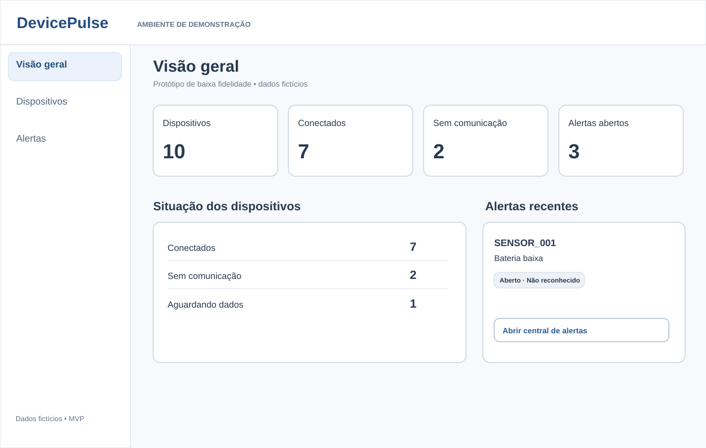](ux/wireframes/11-overview-desktop.svg) | [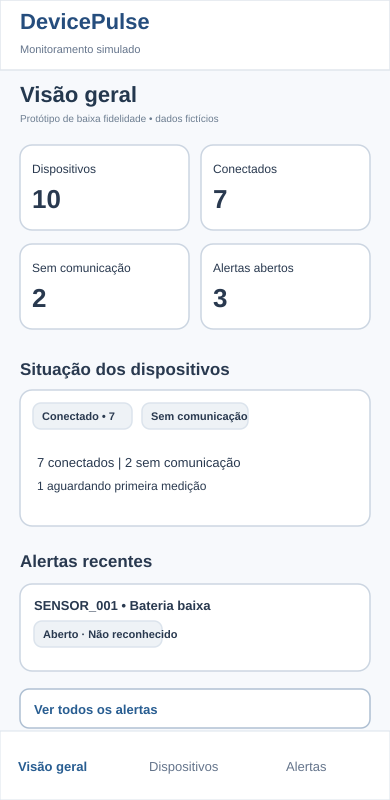](ux/wireframes/11-overview-mobile.svg) |
| **Dispositivos** — Listagem, busca, filtros e paginação. | [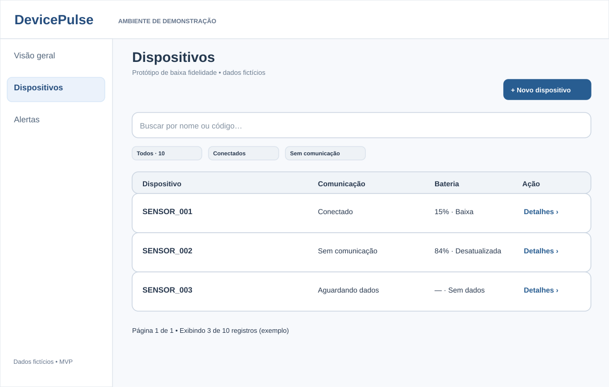](ux/wireframes/11-devices-desktop.svg) | [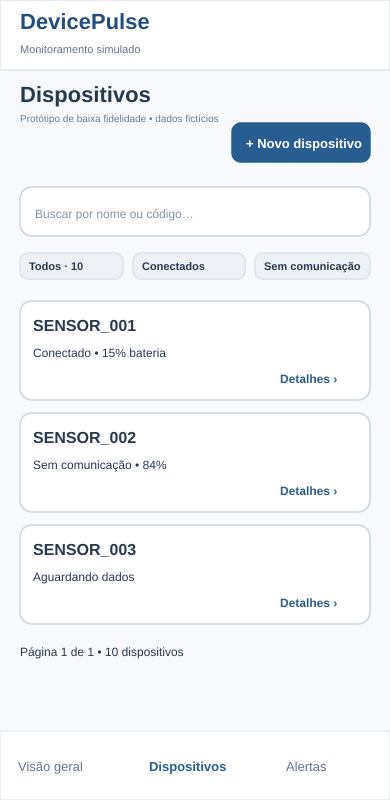](ux/wireframes/11-devices-mobile.svg) |
| **Novo dispositivo** — Cadastro e feedback de validação/sucesso. | [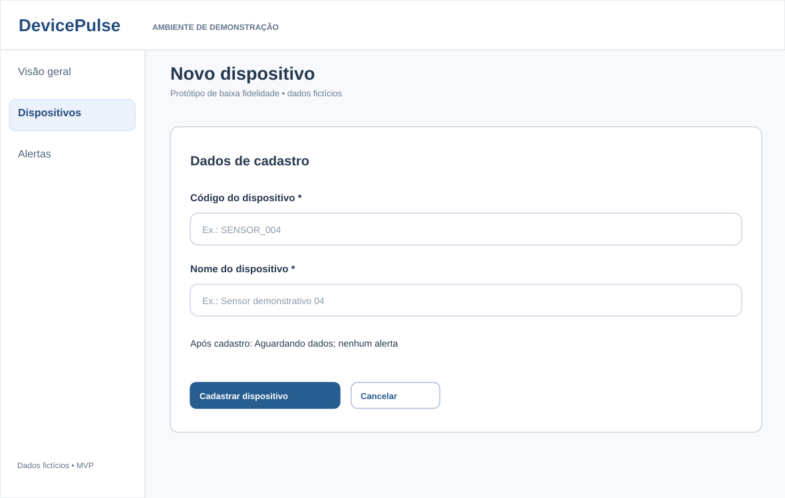](ux/wireframes/11-create-desktop.svg) | [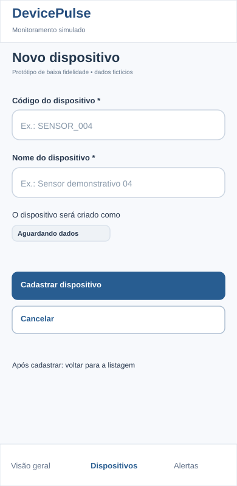](ux/wireframes/11-create-mobile.svg) |
| **Detalhes do dispositivo** — Estado técnico, bateria e histórico cronológico. | [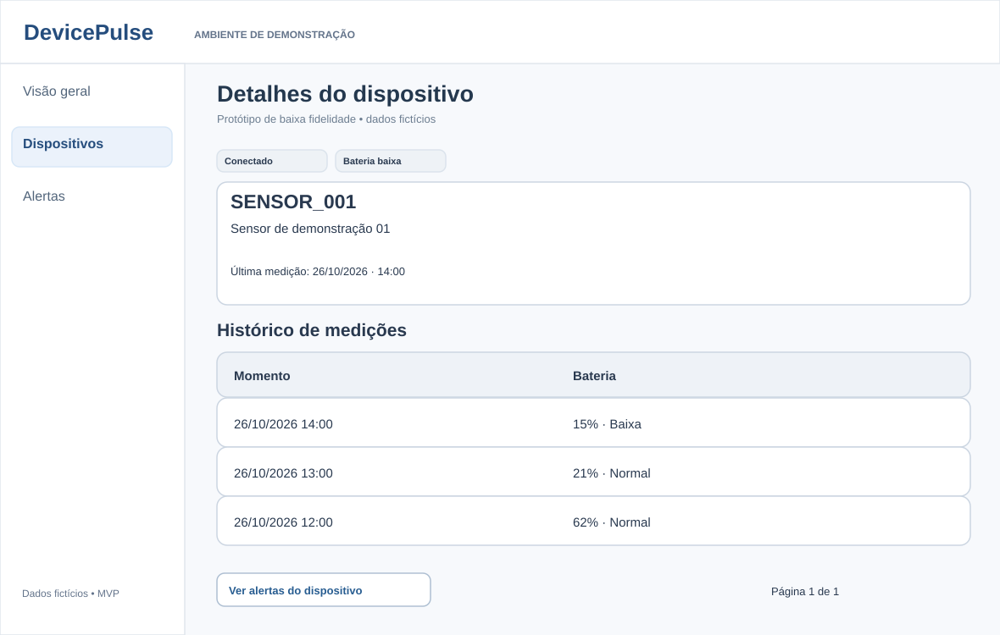](ux/wireframes/11-detail-desktop.svg) | [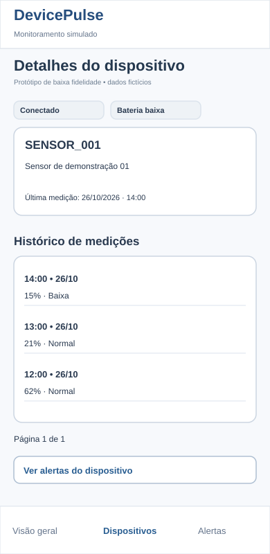](ux/wireframes/11-detail-mobile.svg) |
| **Central de alertas** — Filtros por estado, tipo e reconhecimento. | [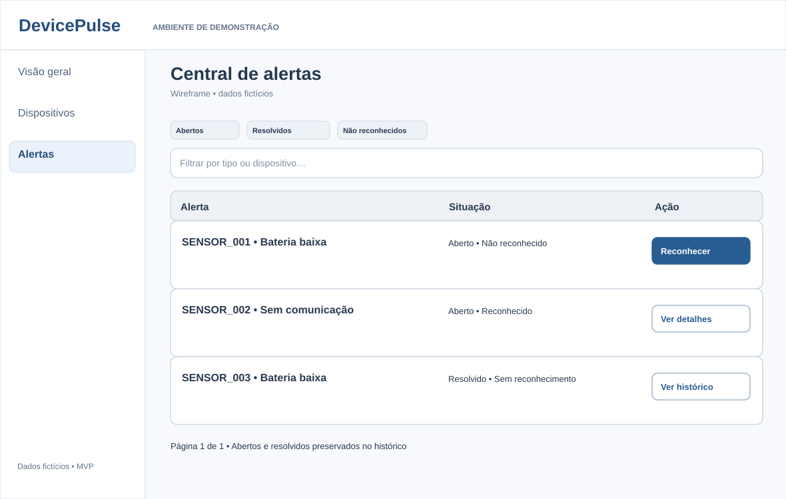](ux/wireframes/11-alerts-desktop.svg) | [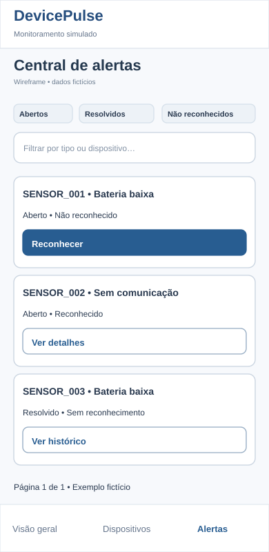](ux/wireframes/11-alerts-mobile.svg) |
| **Detalhes do alerta** — Reconhecimento e datas independentes. | [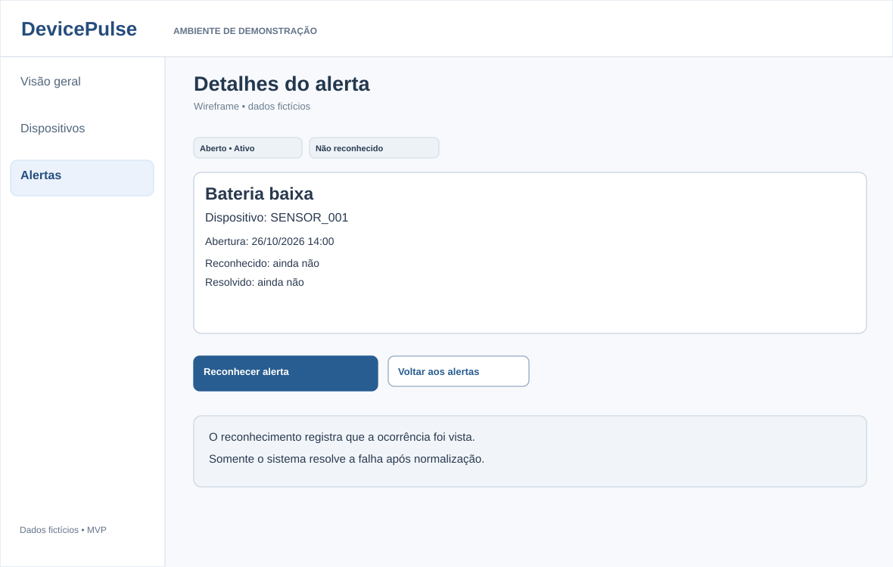](ux/wireframes/11-alert-detail-desktop.svg) | [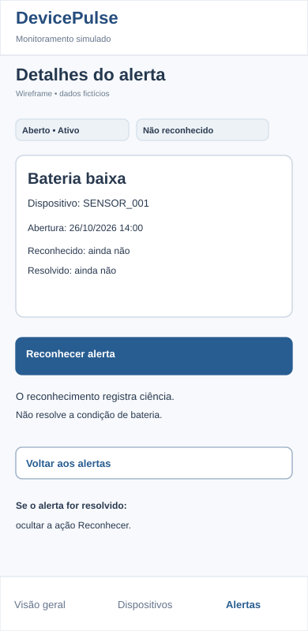](ux/wireframes/11-alert-detail-mobile.svg) |
| **Estados e feedback** — Carregamento, vazio, erro, SEM_DADOS e conflito. | [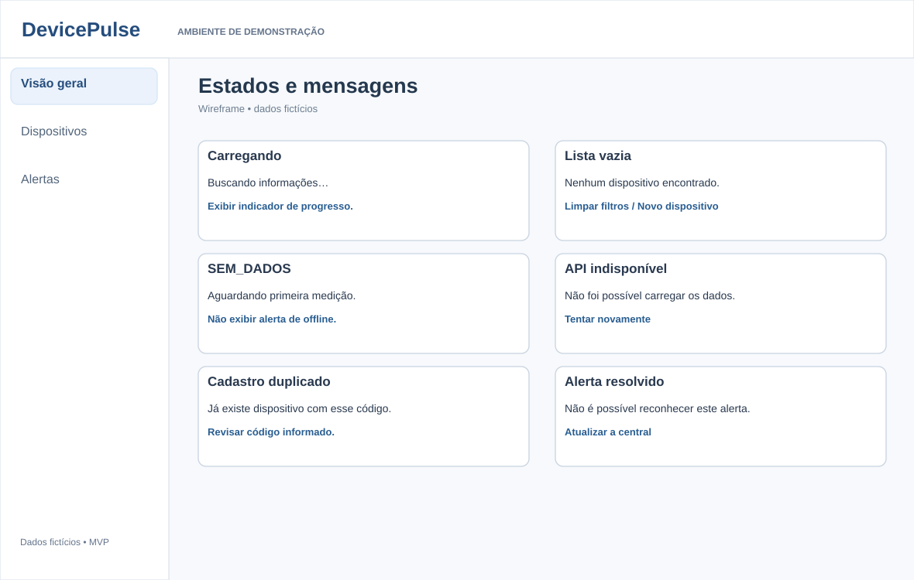](ux/wireframes/11-feedback-desktop.svg) | [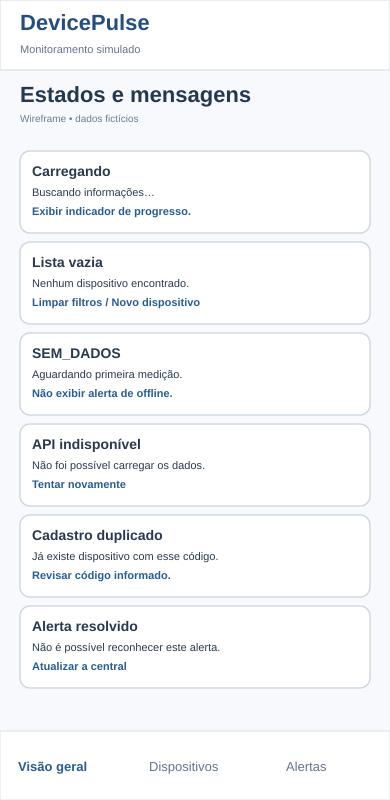](ux/wireframes/11-feedback-mobile.svg) |

**Importante:** os estados de interface são mostrados por cenários separados na última linha; eles não substituem os fluxos de sucesso presentes nas telas principais. É proibido usar um aviso de sucesso quando a API não confirmou gravação.

## 4. Inventário de telas e comportamento esperado

| ID | Tela | Conteúdo e ação principal | Endpoints propostos (DP-010) |
| --- | --- | --- | --- |
| UX-01 | Visão geral | Totais de dispositivos e alertas, estados de comunicação, acesso à central | `GET /dashboard/summary`, `GET /alerts?status=OPEN&page=1&pageSize=20` |
| UX-02 | Dispositivos | Buscar por code/name, filtrar comunicação e paginar; abrir detalhes ou cadastrar | `GET /devices?q&connectivityStatus&page&pageSize` |
| UX-03 | Novo dispositivo | Campos obrigatórios código e nome, validação inline, cadastro e retorno à lista | `POST /devices`; após 201, `GET /devices` |
| UX-04 | Detalhes do dispositivo | Identidade, conexão, bateria atual, instante da última medição, histórico com paginação, acesso a alertas do dispositivo | `GET /devices/{deviceId}`, `GET /devices/{deviceId}/events?page&pageSize`, `GET /alerts?deviceId&status` |
| UX-05 | Central de alertas | Filtrar `OPEN`/`RESOLVED`, `acknowledged`, `alertType`, `deviceId`; abrir detalhe | `GET /alerts?status&acknowledged&alertType&deviceId&page&pageSize` |
| UX-06 | Detalhes do alerta | Exibir tipo, dispositivo, abertura, reconhecimento e resolução; reconhecer **somente enquanto aberto e não reconhecido** | `GET /alerts/{alertId}`, `POST /alerts/{alertId}/acknowledge` |
| UX-07 | Estados e feedback | Carregando, sem resultados, sem eventos, erro da API, código duplicado e alerta resolvido | Comportamento derivado dos códigos da API; sem novas rotas |

O simulador é um programa Node.js separado e **não recebe tela para iniciar/pausar pelo operador no MVP**. A interface também **não** permite exclusão, edição manual de estado do dispositivo, login nem resolução manual de alertas.

## 5. Fluxos de navegação e ações

### 5.1 Navegação das telas

**Arquivo editável:** [11-fluxo-navegacao.mmd](ux/11-fluxo-navegacao.mmd).

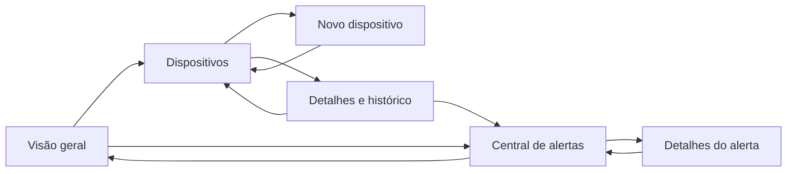

### 5.2 Cadastro com retorno e erros

**Fonte completa:** [11-fluxo-cadastro.mmd](ux/11-fluxo-cadastro.mmd).

1. Operador abre Dispositivos → Novo dispositivo.
2. Formulário possui **código** e **nome**, com erros próximos aos campos.
3. `POST /devices`: durante a solicitação, mostrar “Cadastrando…” e impedir envio duplicado.
4. `201`: confirmar cadastro, mostrar estado inicial **Aguardando dados**, voltar à lista atualizada.
5. `400`: preservar os valores digitados e destacar quais campos precisam de correção.
6. `409`: mensagem “Já existe um dispositivo com esse código”, sem limpar nome nem gerar cadastro fictício.
7. `500/503`: informar que não foi possível confirmar a operação; oferecer nova consulta e tentativa controlada.

### 5.3 Alertas: ler, reconhecer e normalizar

**Fonte completa:** [11-fluxo-alertas.mmd](ux/11-fluxo-alertas.mmd).

1. Operador acessa central e filtra alertas abertos ou resolvidos; reconhecimento é filtro independente.
2. Abre detalhes de uma ocorrência; os horários explicam seu histórico.
3. Se `resolvedAt != null`, a ocorrência está resolvida e **não aparece o botão Reconhecer**.
4. Se está aberta e `acknowledgedAt != null`, mostrar **Reconhecido**, sem solicitar novamente a ação.
5. Se está aberta e `acknowledgedAt = null`, mostrar botão **Reconhecer alerta**.
6. `POST /alerts/{alertId}/acknowledge`: estado “Reconhecendo…” e botão temporariamente desabilitado; após `200`, atualizar detalhe e central e anunciar **“Alerta reconhecido. A condição continua ativa.”**.
7. `409`: o alerta foi resolvido antes da confirmação; atualizar detalhe e mostrar informação sobre resolução. `404`: alerta não encontrado; permitir voltar à central. `500/503`: sem mensagem falsa de sucesso, permitir reconsulta.
8. A resolução ocorre **somente pelas regras do backend**, sem botão do operador. Se a condição normaliza, o alerta pode estar resolvido mesmo sem ter sido reconhecido.

## 6. Estados de interface por componente

| Estado | Local onde aparece | Comportamento do operador |
| --- | --- | --- |
| Carregando | Indicadores, listagens, detalhes | Mostrar carregando/skeleton textual e evitar botões que dependam dos dados indisponíveis |
| Lista vazia | Dispositivos / Alertas | Distinguir entre “sem cadastros/alertas” e “nenhum resultado com estes filtros”; oferecer limpar filtros ou novo dispositivo |
| Sem medição `SEM_DADOS` | Dispositivo recém-criado / Detalhe | “Aguardando dados”; bateria “Sem dados”; não inventar última comunicação nem alerta offline |
| Sem comunicação `OFFLINE` | Lista / Detalhe / Dashboard | “Sem comunicação”; exibir último horário válido; bateria conhecida pode indicar “Desatualizada” |
| Bateria `BAIXA` | Dispositivo / Detalhe / Alertas | Apresentar valor e texto “Bateria baixa”; condição é independente de estar offline |
| Falha de validação 400 | Formulário / filtros | Mensagem junto ao campo ou filtro inválido; manter dados informados |
| Conflito 409 de dispositivo | Cadastro | Orientar troca do código, sem sucesso falso |
| Erro 404 | Detalhe de dispositivo/alerta | Informar recurso inexistente e oferecer voltar à lista |
| Indisponibilidade 503 | Todas as áreas com requisição | Aviso, ação “Tentar novamente”, manter dados anteriores identificados como potencialmente desatualizados |
| Falha 500 | Todas as áreas com requisição | Mensagem genérica e reconsulta; nunca expor stack trace, SQL nem chaves |
| Cadastro confirmado 201 | Cadastro | Confirmação, limpar estado de envio e atualizar lista |
| Reconhecimento 200 | Alerta aberto | Texto “Reconhecido”, horário do servidor; não mostrar “Resolvido” |
| Alerta resolvido | Central/Detalhe | Data de resolução; ocultar ação de reconhecer, mesmo quando não reconhecido |

**Nota:** interface de erro e confirmação depende da resposta do backend. Em uma falha de conexão, uma gravação pode estar sem confirmação para o navegador; consultar dados antes de repetir a operação evita conclusões precipitadas. O contrato de ingestão com `eventId` pertence ao **simulador**, não ao formulário React.

## 7. Regras de responsividade e acessibilidade

- **Desktop:** navegação lateral persistente, indicadores em linha, listagens em tabela e detalhes com ampla área de leitura.
- **Mobile:** menu inferior para Visão geral, Dispositivos e Alertas; cards em coluna; filtros empilhados; ações principais com área de toque adequada.
- **Meta de viewport:** a partir de **360 px**, conforme RNF-006; os desenhos atuais demonstram 390 px e precisam ser testados em 360 px durante a construção.
- **Teclado:** cada link, campo, filtro e ação deve possuir foco visível e seguir ordem lógica. Reconhecer deve ser possível sem mouse.
- **Leitores de tela:** rótulos completos; informar estado e resultado de ações usando região anunciável adequada (por exemplo `aria-live` para mensagens).
- **Sem dependência exclusiva de cor:** “Conectado”, “Sem comunicação”, “Aguardando dados”, “Baixa”, “Reconhecido” e “Resolvido” permanecem expressos como texto.
- **Paginação:** controles “Anterior”/“Próxima” e indicação textual da página; manter ou reiniciar página corretamente após mudança de filtro.
- **Datas:** converter os horários ISO da API para apresentação local consistente e legível (o fuso de saída da API é UTC).
- **Atualização periódica:** usar GET REST configurável com feedback discreto; pausar/distribuir requisições quando apropriado e não sobrescrever dados de formulários com polling.

Os SVGs são representações estáticas de fluxo e hierarquia; **não** certificam navegação por teclado, semântica HTML real nem comportamento responsivo funcional.

## 8. Rastreabilidade com os requisitos

| Fonte | RF e regras | Telas previstas |
| --- | --- | --- |
| DP-003 | RF-001 | UX-02 → UX-03 |
| DP-003 | RF-002/003/004 | UX-02 e UX-04 |
| DP-003 | RF-008 | UX-04 |
| DP-003 | RF-009/010/011 | UX-01, UX-02, UX-04 (estados calculados pelo backend) |
| DP-003 | RF-012/013/014/017 | UX-01, UX-05, UX-06 |
| DP-003 | RF-015/016 | UX-06 (reconhecimento), UX-05/06 (resolução automática exibida) |
| DP-003 | RF-018/019 | UX-01 e atualização por GET |
| DP-003 | RF-020 | UX-03, UX-05, UX-06 e UX-07 |
| DP-004 | RN-007..RN-015 | Textos de comunicação/bateria, leitura desatualizada |
| DP-004 | RN-019..RN-023 | Ação de reconhecer separada da resolução |
| DP-010 | 9 operações REST | UX-01..UX-06 + envio de eventos pela CLI simuladora |

**RF-005/006/007** (simulação/ingestão/validação dos eventos) são cobertos pela **API e simulador** e não se traduzem em uma tela de envio de eventos no MVP; o operador só consulta seus resultados.

## 9. Decisões de UX ainda abertas para implementação

- Identidade visual final, tipografia, espaçamentos e cores de produção (os wireframes não são um design system final).
- Intervalo concreto de atualização automática do dashboard e alertas: ajustável, mas não confundir com o verificador backend de 30 segundos.
- Comportamento de histórico e paginação com grandes volumes, retorno à posição anterior e loading incremental.
- Conferência visual dos wireframes SVGs nos navegadores e layouts efetivos a 360 px, 390 px e desktop.
- Comportamento exato da URL/rota React das páginas (as operações de API não são necessariamente caminhos da SPA).
- Casos de falha concorrente entre reconhecimento, resolução e atualização periódica.

## 10. Checklist de aceitação DP-011

- [x] Os sete conjuntos de telas/estados possuem wireframes **desktop e mobile**.
- [x] Cadastro, busca, filtros, histórico, alertas e reconhecimento estão cobertos por navegação simples.
- [x] Os três arquivos Mermaid descrevem navegação, cadastro e reconhecimento com saídas de erro.
- [x] Cada ação possui operação REST correspondente ou é identificada como regra automática interna.
- [x] `SEM_DADOS`, `ONLINE`, `OFFLINE` e bateria desatualizada são apresentados corretamente.
- [x] Alerta aberto/reconhecido/resolvido não produz interpretação contraditória.
- [x] Falhas 400/404/409/500/503 e estados vazios/carregando possuem feedback.
- [x] O layout mobile foi representado com barra inferior e cards em coluna.
- [x] O documento respeita MVP sem autenticação e sem resolução manual.
- [ ] Conferência visual dos SVGs e revisão de critérios de UX pela responsável.
- [x] Aprovação do DP-011 antes de merge na `main`.

**Aprovação registrada:** a responsável aprovou os wireframes, fluxos e especificação do DP-011 em 27/10/2026. A revisão visual independente dos SVGs em navegadores e a validação de responsividade real em 360 px **não foram executadas nesta etapa**; permanecem como evidências a validar no DP-013 e durante a implementação. A aprovação não significa que a interface React já exista.

**Próxima etapa:** DP-012 — Plano de testes e critérios de aceite.

---

*Protótipos documentais de baixa fidelidade; nenhuma interface executável ou integração com equipamentos reais é representada como concluída.*
